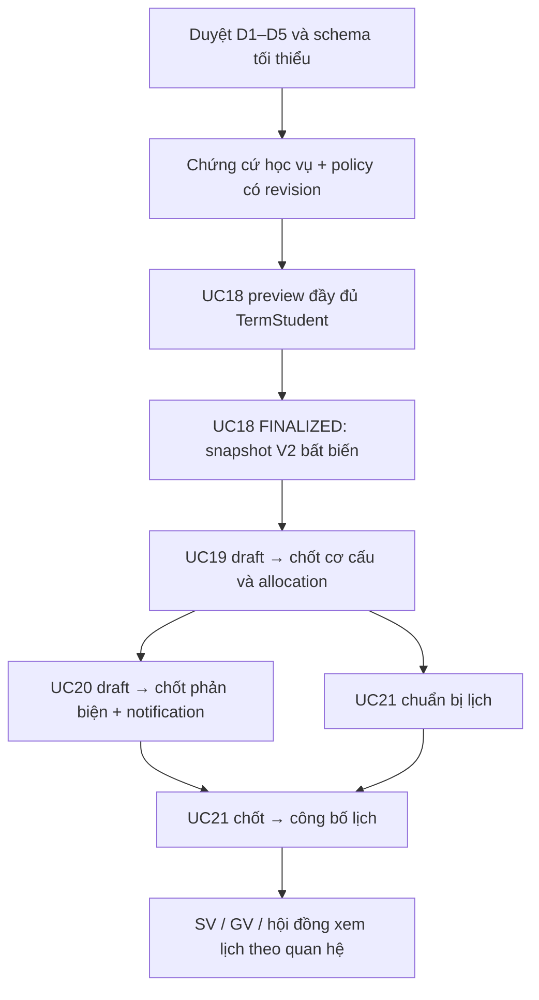

# Kế hoạch tháo chặn UC18–UC21

Ngày rà soát: 27–28/10/2026. Đối chiếu working tree hiện hành, không coi báo cáo gói B/C là trạng thái duy nhất của code.

**Trạng thái: PARTIAL — thiết kế chờ duyệt; chưa có workflow ghi/chốt/công bố chính thức UC18–UC21.** Lượt này chỉ bổ sung một cảnh báo coverage của preview lịch và regression tests. Không sửa Prisma schema/migration, không mở command chính thức hoặc tạo dữ liệu để vượt dependency.

## 1. Căn cứ và hiện trạng đã xác minh

Đã đọc trực tiếp các bảng UC18–UC21 trong `docs/spec/Project_1_06.docx` bằng OOXML, không ghi lại file. Nội dung khớp bản trích `docs/frontend/source-extracts/Project_1_06.md`, Table 50–53, dòng 847–905. Chưa kiểm tra các ảnh nhúng. Các nguồn bổ sung:

- `docs/spec/dac-ta-use-case.md`, phần quy trình Bước 9 và danh sách UC18–UC21.
- `docs/spec/diem-can-xac-nhan.md`: chủ yếu công thức/điều kiện điểm sau chấm; **không xác lập nguồn học vụ, quyền override hay workflow chốt danh sách trước bảo vệ**.
- `docs/implementation/01-business-decisions-and-contract.md`: baseline Bước 4–8, gồm official assignment và grant; không dùng chính sách nhóm duyệt đề cương thay cho Hội đồng bảo vệ.
- `docs/implementation/04-test-plan.md`, `03-team-development-guide.md`: tiêu chí kiểm thử/contract Bước 4–8; chưa có bộ acceptance UC18–UC21 được duyệt riêng. Mục 9 bên dưới là **đề xuất nghiệm thu**, không phải tiêu chí đã được Khoa chấp thuận.
- `docs/audits/project-audit-step9-10.md`, `foundation-stability-h01-h02-h03-m04.md`, `step9-uc17-uc18-implementation.md`, `step9-uc19-uc21-implementation.md`.

| Nguồn code/SQL thực tế                                                                                                                       | Có thể sử dụng                                                                                                  | Khoảng trống thực sự                                                                                                                                      |
| -------------------------------------------------------------------------------------------------------------------------------------------- | --------------------------------------------------------------------------------------------------------------- | --------------------------------------------------------------------------------------------------------------------------------------------------------- |
| `backend/src/defense/defense-lists/defense-list.service.ts`                                                                                  | GET, tạo DRAFT, DRAFT → OPEN; grant toàn đợt cho ghi, khóa THESIS_TERM, CAS, audit cùng transaction             | Chưa có FINALIZE/REOPEN                                                                                                                                   |
| `backend/src/common/uc18-finalization/{prisma-uc18-finalization.reader,uc18-finalization.validator,defense-list-snapshot}.ts`                | OPEN/FINALIZED/UNKNOWN, exact pointer term/revision, snapshot V1, full-roster coverage, canonical SHA-256       | Xác minh bản lịch sử, không phải producer chứng nhận học vụ hoặc phép ghi downstream                                                                      |
| `backend/src/defense/reviews/{defense-review.service,defense-eligibility.policy}.ts`                                                         | Preview từ toàn bộ TermStudent, bao gồm thiếu Proposal/PDF/UC17; giải thích nguyên nhân và stale assignment/PDF | `evaluateDefenseEvidence` luôn thêm `ACADEMIC_SOURCE_NOT_VERIFIED`, trả `officialEligibility=UNKNOWN`, `admitted=false`; không có nguồn học vụ chính thức |
| `backend/src/guidance/defense-confirmations/`                                                                                                | GVHD chính thức hiện hành, UC17 snapshot/history/audit, download đúng PDF identity, UC18 gate                   | Không biến CONFIRMED thành đủ điều kiện học vụ; chưa hỗ trợ nguồn snapshot UC18 V2 được đề xuất dưới đây                                                  |
| `backend/src/defense/planning/{defense-planning.controller,defense-planning.service,defense-planning.repository,defense-planning.policy}.ts` | Đọc/preview thật UC19–21; exact seal UC18 khi có, conflict advisor, cơ cấu, tải phản biện và xung đột lịch      | Không có official mutation; mọi `officialReady` và capability ghi vẫn false; record legacy là UNVERIFIED                                                  |
| `frontend/src/features/defense/{defense-lists,planning}/`                                                                                    | API mode độc lập, JWT, loading/error, preview; không fallback DemoDb                                            | Phương án planning hiện chỉ ở React state, chưa lưu server; nút ghi/chốt/công bố chưa được mở                                                             |
| `backend/prisma/schema.prisma:1036`, migration `202610270001_defense_list_finalization/migration.sql`                                        | DefenseList và DefenseListFinalization đã đủ cấu trúc coordinator và lịch sử chốt UC18                          | Không cần thêm bảng chốt UC18 thứ hai; cần dữ liệu nguồn và policy được duyệt                                                                             |

**Đính chính so với gói C:** `Room.name` hiện có tại `schema.prisma:1120` và SQL gốc `0_init/migration.sql:433` cũng có cột name NOT NULL. Không đề xuất thêm cột này nữa. Đây là quan sát file hiện tại; chưa chứng minh schema PostgreSQL thực đồng bộ.

## 2. A — Ma trận quyết định nghiệp vụ: đúng 5 nhóm cần duyệt

`NEEDS_APPROVAL` nghĩa là đề xuất chưa được thực thi. Khi thiếu cấu hình/bằng chứng, phương án an toàn đang áp dụng là chỉ đọc/preview và chặn ghi; các khuyến nghị bên dưới **không trở thành mặc định vận hành chỉ vì được viết trong tài liệu**.

| Mã                                                     | Quy tắc có căn cứ rõ                                                                                                                                                                                                                                      | Phần còn thiếu                                                                                                                                                                  | Phương án khuyến nghị để duyệt                                                                                                                                                                                                                                                                                                                                                                                                                                                                                                                                                                                                                                                                                    | Nếu chọn phương án khác                                                                                                                                                                                                                                                                                                                                | Trạng thái/phần bị chặn                                                     |
| ------------------------------------------------------ | --------------------------------------------------------------------------------------------------------------------------------------------------------------------------------------------------------------------------------------------------------- | ------------------------------------------------------------------------------------------------------------------------------------------------------------------------------- | ----------------------------------------------------------------------------------------------------------------------------------------------------------------------------------------------------------------------------------------------------------------------------------------------------------------------------------------------------------------------------------------------------------------------------------------------------------------------------------------------------------------------------------------------------------------------------------------------------------------------------------------------------------------------------------------------------------------- | ------------------------------------------------------------------------------------------------------------------------------------------------------------------------------------------------------------------------------------------------------------------------------------------------------------------------------------------------------ | --------------------------------------------------------------------------- |
| **D1 — Chứng cứ học vụ và ngoại lệ UC18**              | UC18 cần nguồn học vụ/nợ học phần được xác nhận. Thiếu xác nhận GVHD hoặc bị từ chối không vào danh sách chính. Roster phải đầy đủ; CONFIRMED không đủ để tự admit.                                                                                       | Nguồn và người chứng nhận học vụ; dữ liệu/độ mới của nguồn; bảo lưu quay lại, đủ sau bổ sung, phản biện nhưng chưa bảo vệ. DOCX ghi nhập thủ công là đề xuất cần Khoa xác nhận. | Giai đoạn đầu cho người có permission xác minh + grant toàn đợt ghi **chứng cứ thủ công theo TermStudent**, có nguồn tham chiếu/nội dung đối soát, kết luận và actor/time/revision. Chỉ admit trường hợp chuẩn khi học vụ được chứng nhận đạt, Proposal APPROVED, GVHD hiện hành CONFIRMED đúng PDF hiện hành đã xác minh. Ca đặc biệt giữ nhãn NEEDS_REVIEW và loại khỏi tập được bảo vệ tới khi có quyết định/bằng chứng riêng; không bị loại khỏi roster. `Student.academicEligible`, GPA và một note legacy không thay chứng cứ.                                                                                                                                                                              | Đồng bộ hệ thống học vụ cần contract, định danh nguồn, xử lý nguồn lỗi/độ mới; có thể không cần bảng nhập thủ công. Nếu muốn cho ca đặc biệt vào danh sách ngay, phải duyệt điều kiện và liên kết hồ sơ cũ; không thể chỉ map DEFERRED thành admitted.                                                                                                 | **NEEDS_APPROVAL** — producer eligibility và FINALIZE UC18                  |
| **D2 — Quyền, mốc thời gian và sửa/mở lại toàn chuỗi** | UC18 chốt **toàn đợt**; permission + AcademicTermGrant allDepartments=true. UC17 chỉ ghi khi UC18 OPEN và cửa sổ riêng mở. Nộp lại PDF không sửa UC17/UC18. UC19 khóa cơ cấu sau chốt; đổi lịch đã công bố cần audit/thông báo.                           | Mốc UC18/chốt hội đồng/phản biện/công bố; ai được sửa sau chốt; xử lý ảnh hưởng downstream khi REOPEN; quyền bộ môn trên draft nội bộ.                                          | Giữ người có permission riêng + grant toàn đợt cho các command có hiệu lực; bộ môn tiếp tục đọc/đối soát đúng scope, chưa cấp ghi cả đợt. Cấu hình các mốc độc lập có khóa/revision, không lấy FINAL hay hạn UC17 làm fallback. REOPEN bắt buộc reason + preview tác động + expected revision/context: nếu có downstream đã chốt/công bố, chỉ thực hiện qua **lệnh mở lại có kiểm soát** đồng thời vô hiệu pointer hiện hành downstream, giữ toàn bộ artifact lịch sử, audit và thông báo thu hồi/điều chỉnh; không cascade ngầm khi PDF đổi. Trước khi lệnh này được xây dựng/kiểm thử, chặn REOPEN có downstream chính thức. STALE/UNKNOWN chặn command mới, không làm reader đổi lịch sử FINALIZED thành OPEN. | Phương án nhỏ hơn là chỉ cho REOPEN trước UC19 FINALIZED; triển khai nhanh nhưng chưa xử lý sửa upstream sau khi đã lập hội đồng. Cho sửa từng record bỏ qua dependency sẽ làm lịch/phản biện trỏ danh sách cũ. Nếu cho bộ môn ghi phải thiết kế ownership của hội đồng và xử lý giao thoa giảng viên; allDepartments không được suy từ ADMIN/FACULTY. | **NEEDS_APPROVAL** — policy thời gian, FINALIZE/REOPEN và mutation sau chốt |
| **D3 — Cơ cấu và sức chứa hội đồng UC19**              | 3–5 giảng viên, có Chủ tịch/Thư ký, kiểm tra trùng/thành phần; chặn GVHD trong hội đồng chấm SV mình; chỉ SV thuộc tập UC18 admitted. Cho phép phân bổ thủ công.                                                                                          | Số người cụ thể trong dải; nhiều người cùng chức danh? sức chứa bao nhiêu SV/hội đồng/buổi, cảnh báo hay chặn; tính số hội đồng theo tham số nào.                               | Chọn size 3–5 **qua cấu hình rõ**, đúng 1 Chủ tịch + 1 Thư ký khác người, còn lại Ủy viên; mỗi hồ sơ trong tập cần phân bổ chỉ có một hội đồng hiện hành. Nhập sức chứa SV/hội đồng là số dương theo quyết định Khoa, không có số mặc định và không lấy Room.capacity; chặn vượt khi chốt. Cho phân thủ công trước, gợi ý chia đều là trợ giúp có thể chỉnh. Không đưa quorum chấm điểm vào UC19.                                                                                                                                                                                                                                                                                                                 | Cho nhiều Chủ tịch/Thư ký cần cách xác định người chịu trách nhiệm và hợp đồng UC23 sau này. Cảnh báo thay vì chặn sức chứa cần explicit override/reason. Nếu không cấu hình sức chứa thì chỉ preview, không tính được số hội đồng cần lập theo yêu cầu.                                                                                               | **NEEDS_APPROVAL** — schema/policy UC19 official                            |
| **D4 — Quy tắc phản biện UC20**                        | GVHD không phản biện SV mình, không trùng phân công, có cân bằng tải/cảnh báo, Khoa chỉnh và chốt rồi thông báo; nguồn là UC19 đã chốt.                                                                                                                   | Số GVPB; phải thuộc hội đồng của SV hay chỉ roster đợt; ngưỡng tải/chuyên môn và thuật toán gợi ý. Quota TermLecturer hiện là quota hướng dẫn, không phải phản biện.            | Đề nghị **1 GVPB/hồ sơ** trong giai đoạn đầu, lấy giảng viên hoạt động thuộc TermLecturer của đợt, khác GVHD, không bắt buộc cùng hội đồng. Cho chỉnh thủ công; gợi ý giảng viên có tải phản biện thấp nhất, tie-break ổn định theo mã, không áp quota hướng dẫn. Hiển thị tải; ngưỡng cảnh báo do Khoa cấu hình, chưa có ngưỡng thì không tự đặt con số. Tiêu chí chuyên môn chỉ dùng khi có nguồn mapping được xác nhận.                                                                                                                                                                                                                                                                                        | Nhiều GVPB hoặc bắt buộc cùng hội đồng ảnh hưởng cardinality, UI, conflict lịch và contract chấm UC22/24; không sửa công thức điểm ở lượt này. Hard quota cần nguồn/quy trình override; heuristic chuyên môn từ tên đề tài không có thẩm quyền.                                                                                                        | **NEEDS_APPROVAL** — official assignment, gợi ý và thông báo UC20           |
| **D5 — Lịch và công bố UC21**                          | Ngày/giờ/phòng/buổi, tránh trùng hội đồng/giảng viên/phòng; Khoa chỉnh/chốt/công bố, SV/GV/HĐ xem lịch; thay lịch công bố phải thông báo lại. Alphabet trong DOCX chỉ áp dụng nếu Khoa xác nhận; bản Markdown tóm tắt ghi tự động, không tự chọn bên nào. | Thời lượng/buổi, quy tắc Alphabet và tie-break, GVPB/GVHD có bắt buộc dự; hard conflict hay override; quyền xem draft và tách chốt với công bố.                                 | DRAFT → FINALIZED → PUBLISHED; nhập start/end cụ thể theo buổi, không dùng default 30 phút làm policy. Khuyến nghị chặn trùng tài nguyên đã biết; GVPB tham dự được tính conflict, GVHD không mặc nhiên bắt buộc dự. Mặc định đề xuất sắp thủ công; bật Alphabet Tên + Họ đệm chỉ sau duyệt quy tắc tên tiếng Việt và tie-break mã SV. Chỉ Khoa đủ grant xem draft toàn đợt; người liên quan xem phần lịch PUBLISHED của mình. Amendment sau công bố tạo version mới + audit + thông báo cho tập người bị ảnh hưởng.                                                                                                                                                                                              | Cho sửa tại chỗ sẽ mất lịch công bố cũ. Cho GVHD bắt buộc dự tăng tài nguyên conflict. Dùng một mốc cho cả chốt/công bố giảm trạng thái nhưng bỏ bước kiểm tra trước công khai. Alphabet tự động không có quy tắc chuẩn có thể xếp sai họ/tên ghép.                                                                                                    | **NEEDS_APPROVAL** — slot, attendance, công bố và sửa lịch                  |

Không cần hỏi lại các nguyên tắc đã chốt: không ADMIN bypass, không phase thứ bảy, không lấy PUBLISHED assignment làm official, không tự thu hồi UC17 khi reupload, không đồng nhất ELIGIBLE với FINALIZED. Không đặt thêm câu hỏi quorum chấm điểm UC23 hoặc công bố điểm UC24 trong gói này.

## 3. B — Prisma tối thiểu: tái sử dụng trước, bổ sung có điều kiện

### 3.1. Các cấu trúc dùng lại, không tạo trùng

| Model                                                             | Sử dụng/giới hạn                                                                                                                                                                                               |
| ----------------------------------------------------------------- | -------------------------------------------------------------------------------------------------------------------------------------------------------------------------------------------------------------- |
| ThesisTerm, TermStudent, TermLecturer, Proposal                   | Phạm vi đợt, roster đầy đủ, ownership; không gán Proposal cho SV thiếu hồ sơ hoặc lấy roster chỉ từ Proposal                                                                                                   |
| TermWorkflow, AssignmentPlan, AdvisorAssignment, AssignmentChange | Official pointer + FINALIZED + assignment revision hiện hành; GuidancePlan/role LECTURER không phải nguồn GVHD                                                                                                 |
| FinalReport, FileAsset                                            | PDF hiện hành, revision/checksum, kiểm tra owner/bytes; snapshot chỉ metadata, không FK lịch sử tới FileAsset cũ                                                                                               |
| DefenseConfirmation, DefenseConfirmationHistory                   | Quyết định và chứng cứ UC17; giữ legacy revision=0, append-only history, confirmedAt đúng trạng thái                                                                                                           |
| DefenseList, DefenseListFinalization                              | Giữ nguyên state DRAFT/OPEN/FINALIZED, version/hash và pointer ghép term/revision; không thêm bảng chốt UC18 khác                                                                                              |
| DefenseEligibility, DefermentRequest                              | Có thể hiển thị legacy, hoặc cập nhật projection eligibility qua command đã duyệt; không lấy status/note/checkedAt làm bằng chứng Khoa đã chốt/học vụ đã xác minh; không đổi enum cũ để nhét trạng thái UI mới |
| DefenseCommittee, CommitteeMember                                 | Danh mục/cơ cấu vật lý có thể tái sử dụng. Chưa có state/revision/provenance; row tồn tại chưa chứng minh official                                                                                             |
| ReviewerAssignment                                                | Unique(proposalId,reviewerId) đã có; chưa thể hiện bản phân công nào được chốt. Không dùng lại ProposalReviewAssignment Bước 5                                                                                 |
| Room, DefenseSession, CommitteeStudent                            | Có thể tái sử dụng danh mục phòng/lịch legacy và kiểm tra xung đột. CommitteeStudent buộc sessionId nên **không thể làm nguồn phân SV–hội đồng của UC19 trước khi có lịch**                                    |
| AuditLog, Notification, OutboxEvent, IdempotencyRecord            | Dùng infrastructure hiện có, caller transaction, eventId unique/idempotency key. Không tạo email worker riêng hoặc giả định mọi loại event đã có consumer gửi mail                                             |

### 3.2. Thiết kế được khuyến nghị để duyệt — chưa sửa schema

Ưu tiên **3 model mới và một nhóm cột cấu hình trên DefenseList** nếu chọn nguồn học vụ thủ công D1. Hai model workflow dùng chung UC19–21, không tạo ba bộ coordinator/history riêng. JSON ở đây là tài liệu chính thức lưu PostgreSQL với validator/hash/revision, không phải DemoDb hay giả lập lưu thành công.

| Phân loại                                                  | Thay đổi đề xuất                                                                                                                                        | Cấu trúc/constraint chính                                                                                                                                                                                                                                                                                                                                                                           | Lý do                                                                                                                                                                                                                                                                                                                                                                        |
| ---------------------------------------------------------- | ------------------------------------------------------------------------------------------------------------------------------------------------------- | --------------------------------------------------------------------------------------------------------------------------------------------------------------------------------------------------------------------------------------------------------------------------------------------------------------------------------------------------------------------------------------------------- | ---------------------------------------------------------------------------------------------------------------------------------------------------------------------------------------------------------------------------------------------------------------------------------------------------------------------------------------------------------------------------- |
| **Bắt buộc nếu D1 chọn nhập/xác nhận thủ công**            | `DefenseAcademicEvidence` / `DEFENSE_ACADEMIC_EVIDENCE`, append-only                                                                                    | id PK; termId FK RESTRICT; termStudentId, studentId là định danh snapshot; revision dương; verdict, sourceKind, sourceReference/nội dung đối soát, schemaVersion, evidence JSON, contentHash, verifiedAt, verifiedByUserId FK RESTRICT. Unique(termId,termStudentId,revision); index(termId,studentId,revision). CHECK revision/version/hash/envelope/metadata; trigger cấm UPDATE/DELETE/TRUNCATE. | Một bằng chứng sửa sai bằng bản mới, không rewrite bản đã dùng khi chốt. Server xác minh chính xác TermStudent thuộc term/student trong transaction; không thêm RESTRICT FK lên TermStudent làm đổi luồng xóa roster Bước 1. Không có hàng thì UNKNOWN. Nếu có external source đáng tin cậy, có thể thay bảng này bằng adapter read-only và snapshot provenance tương đương. |
| **Bắt buộc cho cấu hình D2–D5 theo phương án này**         | Thêm nullable `workflowPolicy` JSON, `workflowPolicyRevision` int default 0, `workflowPolicyUpdatedAt`, `workflowPolicyUpdatedByUserId` vào DefenseList | FK actor RESTRICT; CHECK policyRevision không âm và metadata có cùng khi policy được cấu hình. JSON có schemaVersion; các mốc named riêng UC18/UC19/UC20/UC21 với opensAt/closesAt/isLocked và các lựa chọn D1–D5. Mốc thiếu → chặn command tương ứng. Policy CAS riêng, audit cùng transaction.                                                                                                    | Không thêm phase, không đổi TermWindowService, không thêm bảng cấu hình cho từng mốc. Policy revision riêng để không làm hỏng FK hiện tại giữa DefenseList.revision và listRevision của bản chốt. Đang FINALIZED chỉ cho sửa policy qua quy trình D2 đã duyệt; artifact ghi nguyên policy đã dùng.                                                                           |
| **Bắt buộc có năng lực tương đương trước khi UC19–21 ghi** | `DefenseStageWorkflow` / `DEFENSE_STAGE_WORKFLOW`                                                                                                       | PK(termId,stage), stage COMMITTEES/REVIEWERS/SCHEDULE; state DRAFT/FINALIZED/PUBLISHED; revision int ≥0; draft JSON nullable; sourceUc18FinalizationId; upstreamStage/upstreamArtifactId; currentArtifactId; timestamps/actor. FK tới DefenseList, UserAccount, bản chốt nguồn; CHECK state theo stage (PUBLISHED chỉ SCHEDULE).                                                                    | Coordinator từng stage cho toàn đợt, lưu draft server, CAS, nguồn chính thức. Chỉ tạo/lưu khi UC18 FINALIZED; trước đó vẫn chỉ preview không lưu. Không sửa các bảng legacy để tự coi chúng là draft hay official.                                                                                                                                                           |
| **Bắt buộc đi cùng coordinator**                           | `DefenseStageArtifact` / `DEFENSE_STAGE_ARTIFACT`, append-only                                                                                          | id PK; termId/stage FK coordinator; version>0; workflowRevision>0; state được chốt; snapshotSchemaVersion>0; snapshot JSON; SHA-256; sealedAt/by. Unique(termId,stage,version), unique(termId,stage,workflowRevision), unique(id,termId,stage,workflowRevision). Trigger chặn UPDATE/DELETE/TRUNCATE, RESTRICT lịch sử/actor/nguồn.                                                                 | Lịch sử chốt hội đồng, chốt phản biện và chốt/công bố lịch. Snapshot chứa allocation độc lập session, member roles, reviewer list hoặc slots, source artifact identities/hash, policy snapshot và evidence revision. Không rewrite artifact khi mở lại.                                                                                                                      |

Các chi tiết FK/pointer cần có trong migration tương lai:

1. `DefenseStageWorkflow.currentArtifactId + termId + stage + revision` → `DefenseStageArtifact.id + termId + stage + workflowRevision`; unique tuple được tham chiếu. Pointer null khi DRAFT, bắt buộc khi FINALIZED/PUBLISHED. Chỉ tăng revision và giữ state đã chốt khi đồng thời tạo artifact mới đúng revision; mở lại phải clear pointer trong cùng UPDATE. Khi SCHEDULE FINALIZED → PUBLISHED, tạo artifact publication mới ở revision mới, không chỉ tăng revision của coordinator làm FK sai.
2. FK nguồn UC18 `(sourceUc18FinalizationId,termId)` → `(DefenseListFinalization.id,termId)`: cần thêm unique(id,termId) nếu dùng đúng tuple này; không tạo lại FK hiện có `(id,termId,listRevision)`. Có thể thay bằng tuple có listRevision để tái sử dụng unique sẵn có, nhưng phải lưu cả sourceListRevision. **Khuyến nghị tuple ba cột sẵn có** để ít index hơn.
3. Nguồn stage trước phải cùng term và đúng loại: COMMITTEES không có upstream stage, REVIEWERS chỉ trỏ COMMITTEES, SCHEDULE trỏ REVIEWERS theo dependency được đề xuất. Dùng upstreamStage với CHECK mapping và FK ghép `(upstreamArtifactId,termId,upstreamStage,upstreamRevision)` tới artifact. Không chỉ kiểm id trong application. Snapshot SCHEDULE giữ cả nguồn UC19 và UC20 và server xác minh UC20 thực sự dựa trên đúng UC19 đó.
4. FK chứng minh một bản nguồn **từng tồn tại**, không chứng minh nó còn là bản hiện hành. Transaction phải so pointer nguồn hiện hành/UC18 state sau khóa. Không viết CHECK SQL tham chiếu bảng khác để giả lập điều kiện này.
5. Index coordinator(termId,state) nếu query kế hoạch theo state; artifact unique(termId,stage,version) phục vụ history. Chỉ thêm index actor/time khi có truy vấn audit/history cần dùng. Kiểm tra kế hoạch truy vấn trên PostgreSQL cô lập trước khi thêm GIN cả snapshot lớn.
6. Shape JSON, danh sách không trùng, đủ coverage, size 3–5, conflict, reviewer cardinality theo policy, start<end/orderIndex, owner/term và hash xác minh bằng typed validator trong transaction. CHECK thường không đếm được member rows hoặc chứng nhận nguồn học vụ; unique SQL không thay validation nội dung JSON.

**Nguồn sự thật đề xuất:** coordinator + artifact đã xác minh. UC19 lưu allocation trong draft/snapshot có cấu trúc, hoàn toàn độc lập DefenseSession. UC20 lưu reviewer assignments trong artifact. UC21 lưu session/slot start/end/order/room/attendees trong artifact. Đây là phương án ít thay bảng cũ nhất; cần duyệt cách lưu này trước khi code writer. Không lấy `CommitteeStudent` để tạo session giả ở UC19.

Các bảng legacy vẫn có thể là read projection sau này. Nếu cần materialize vào DefenseCommittee/ReviewerAssignment/DefenseSession/CommitteeStudent, phải bổ sung nullable provenance tới artifact cho **hàng mới**, viết projection cùng transaction, kiểm tra khớp artifact và không xóa/đánh dấu official dữ liệu cũ tự động. Không bắt buộc dual-write chỉ để endpoint C01 đọc lại được; C01 vẫn khóa.

### 3.3. Tùy chọn, không bắt buộc để happy path hoạt động

- Tách `DefenseCommitteeAllocation` (unique termId/proposalId, FK committee cùng term) và `DefenseScheduleSlot` (unique publication/proposalId, start/end/order có constraint) nếu ưu tiên truy vấn quan hệ thay JSON. Đây là **phương án lưu thay thế/projection**, không phải bảng bắt buộc khi đã chọn artifact làm authority. Cần chốt một hướng để không có hai nguồn sự thật.
- Bảng booking tài nguyên theo resource/range với GiST exclusion để DB tự chặn overlap. Nếu chưa dùng thì writer phải khóa tài nguyên xuyên đợt và đọc lại lịch; preview không giữ chỗ. Không tự cài extension PostgreSQL ở lượt này.
- Link hồ sơ bảo lưu cũ/mới, nguồn chuyên môn giảng viên, hard reviewer quota: chỉ thêm khi D1/D4 được duyệt; không mượn quota hướng dẫn.
- Tách cấu hình policy thành một bảng typed có lịch sử nếu quản trị cần query/report từng trường; không bắt buộc thêm nhiều bảng window chỉ vì hai mốc PDF/UC17 đang dùng bảng riêng.

### 3.4. Tương thích schema/SQL và dữ liệu Bước 1–8

- `0_init/migration.sql:404–470` đã có FK Proposal cho DefenseEligibility, ReviewerAssignment, CommitteeStudent; Prisma hiện chưa khai báo đầy đủ relation. Nếu bổ sung relation phải map đúng constraint và hành vi FK sẵn có, không generate FK trùng. SQL gốc dùng VARCHAR cho một số status trong khi Prisma có enum; cần đối soát chuỗi migration hiện hành trước khi generate SQL, không tự chuyển kiểu hoặc suy schema thật từ Prisma.
- Một số cascade/nullable ở SQL gốc khác mặc định relation hiện tại. Không “sửa tiện” chính sách xóa legacy. Bảng artifact mới bảo toàn lịch sử bằng RESTRICT và snapshot ID thuần cho dữ liệu có thể biến mất; tác động đến xóa term/user phải được ghi vào hướng dẫn vận hành/retention, không silently đổi Bước 1–8.
- Giữ `FinalReport.filePath` legacy; không tạo bản PDF cũ hoặc FK tới FileAsset cũ. Không backfill CONFIRMED/ELIGIBLE, không tạo history/artifact giả hoặc mặc định OPEN/PUBLISHED.
- `TermParameter.value` là String nhưng API hiện là record số: `term.dto.ts`, `term-configuration.validator.ts:82`, `term.mapper.ts:5` và `TermRepository.replaceParameters:141`. Không ghi JSON policy vào API số rồi mặc định nó có CAS/provenance. Không sửa parser/validator chung Bước 1–8 để lách schema. Cấu hình mới dùng vùng riêng đề xuất trên DefenseList.
- Snapshot UC18 V1 hiện **không có provenance học vụ/policy**. Đề xuất producer mới dùng **V2**, thêm academic evidence identity/revision/hash, classification và policy context trong từng bản chốt. Reader phải đọc V1/V2 theo version rõ ràng, vẫn xác minh và giữ nguyên bản lịch sử V1 hợp lệ; không sửa/hardcode nâng V1. Downstream mới yêu cầu nguồn có đủ provenance, V1 thiếu thì NEEDS_REVIEW và không ghi, dù reader lịch sử vẫn FINALIZED. `planning.service.ts` hiện chỉ nhận V1 nên cập nhật consumer cùng đợt với V2, không rollout producer đơn độc.

## 4. C — Chuỗi dependency và thứ tự triển khai

UC21 có thể chuẩn bị phương án sau UC19; theo kế hoạch này chưa chốt/công bố khi UC20 chưa chốt. DOCX UC21 ghi precondition UC19, không khẳng định UC20 phải chốt trước mọi thao tác draft; dependency mạnh hơn ở công bố cần được duyệt trong D5 và khớp kiểm tra phản biện đang có.

| Thứ tự | Công việc cụ thể và file dự kiến                                                                                                                                                                                                        | Làm ngay hay phải chờ?                                                                            | Đầu ra kiểm chứng                                                                                                                                           |
| ------ | --------------------------------------------------------------------------------------------------------------------------------------------------------------------------------------------------------------------------------------- | ------------------------------------------------------------------------------------------------- | ----------------------------------------------------------------------------------------------------------------------------------------------------------- |
| **0**  | Đối chiếu DOCX/code/migration; giữ C01 khóa; bổ sung coverage warning vào `backend/src/defense/planning/defense-planning.policy.ts` và test                                                                                             | **ĐÃ LÀM trong lượt này**, không cần schema/policy mới                                            | Unit/HTTP mock, xem mục 7                                                                                                                                   |
| **1**  | Typed contract/validator học vụ, policy và stage artifact; `shared/src/contracts/defense-eligibility.ts`, `defense-workflow.ts` dự kiến; snapshot V2 trong `backend/src/common/uc18-finalization/`; giữ port `read(termId,transaction)` | Có thể chuẩn bị test skeleton/contract kỹ thuật ngay; chỉ đóng contract nghiệp vụ sau duyệt D1–D5 | Tests UNKNOWN, version cũ/mới, duplicate roster, policy thiếu, stale, no automatic admit; không fake status writer                                          |
| **2**  | Schema/migration bổ sung theo mục 3; `backend/prisma/schema.prisma`, **một migration mới** sau duyệt; không sửa migration cũ                                                                                                            | **NEEDS_APPROVAL** — chưa tạo trong lượt này                                                      | Prisma validate, static SQL review; replay/legacy upgrade trên PostgreSQL cô lập ở đợt được phép                                                            |
| **3**  | `backend/src/defense/academic-evidence/` và policy configuration trong `defense-lists/`; repository/service/DTO/controller/test                                                                                                         | Chờ D1/D2 + schema                                                                                | Create evidence append-only, đúng term/student, CAS, quyền/grant, audit rollback; không đồng bộ Student flag                                                |
| **4**  | Nâng `defense/reviews/defense-eligibility.policy.ts`, `defense-review.service.ts`; private PDF verification và expected preview context chứa toàn roster/evidence/policy                                                                | Có thể tái sử dụng reader/validators hiện có; xét đủ điều kiện thật phải chờ nguồn bước 3         | Chưa có học vụ → UNKNOWN; không Proposal/UC17/PDF vẫn có dòng, phân biệt roster và admitted, không hard-block do tiến độ                                    |
| **5**  | `defense-lists/` thêm FINALIZE/REOPEN command, validator/repository/audit; `common/uc18-finalization/` reader V2; cập nhật `planning.service.ts` nhận provenance mới                                                                    | Chờ D1/D2, bước 3–4                                                                               | Insert seal rồi CAS pointer/revision, kiểm tra lại reader cùng transaction; FINALIZED chặn UC17, mở lại không gia hạn UC17; downstream impact được xác nhận |
| **6**  | `defense/planning/` thêm stage repository/command service/artifact validators cho UC19; lưu draft, phân SV độc lập lịch, gợi ý/điều chỉnh, finalize                                                                                     | Chờ schema + D3 + UC18 FINALIZED                                                                  | 3–5, roles, capacity đã duyệt, exact admitted coverage, official advisor conflict, source stale/concurrent seal bị từ chối                                  |
| **7**  | UC20 command/preview trong planning; gợi ý cân bằng, save draft/finalize, notification/outbox cùng transaction                                                                                                                          | Chờ UC19 FINALIZED + D4                                                                           | Đủ số reviewer theo policy, không GVHD, không trùng/ngoài roster; old advisor đổi làm context 409; rollback event/audit không để phân công nửa chừng        |
| **8**  | UC21 command + published reader; global booking locks, draft/finalize/publish/amend theo D5                                                                                                                                             | Chờ UC19 và UC20 nguồn hiện hành + D5                                                             | Conflict xuyên đợt, lịch đầy đủ, không lộ draft cho SV/GV; công bố version mới, thông báo đúng người; không API export/điểm                                 |
| **9**  | Nâng `frontend/src/features/defense/defense-lists/api.ts`, `page.tsx` và `frontend/src/features/defense/planning/api.ts`, `layout.tsx`, `pages.tsx`                                                                                     | Từng màn hình bật capability thật sau backend tương ứng; không mở nút trước                       | Lưu server/refresh thật, lỗi không fallback, 409 yêu cầu xem lại, preview khác save/chốt/publish; API flags hiện có vẫn opt-in                              |
| **10** | HTTP mock/unit toàn chuỗi, rồi PostgreSQL cô lập và browser acceptance                                                                                                                                                                  | Mock/regression **làm ngay**; PostgreSQL và dữ liệu test **không chạy trong lượt này**            | Các ca mục 9, không dùng fixture in-memory để tuyên bố workflow thực đã nghiệm thu                                                                          |

Các tên file/model mới ở bảng là kế hoạch, chưa tồn tại do lượt này tạo. Không cần viết lại JWT, grant resolver, official advisor resolver, private storage hoặc UC17 command.

## 5. API và permission dự kiến sau duyệt

Giữ toàn bộ GET/POST preview hiện có. Namespace dưới `/api`:

| API dự kiến                                                                               | Điều kiện và dữ liệu                                                                                                                           |
| ----------------------------------------------------------------------------------------- | ---------------------------------------------------------------------------------------------------------------------------------------------- |
| GET/POST `/terms/:termId/defense-list/academic-evidence`                                  | Đọc theo grant; ghi chứng cứ mới theo D1, không tin actor/student owner từ body, scope TermStudent server kiểm tra                             |
| GET/PUT `/terms/:termId/defense-list/workflow-policy`                                     | Policy cấu hình rõ, expectedPolicyRevision, audit, không sinh mặc định; allDepartments cho ghi                                                 |
| POST `/terms/:termId/defense-list/finalize`                                               | expectedRevision, expectedContext/hash preview đầy đủ, policy revision, idempotency key; server tạo snapshot/actor/time/hash                   |
| POST `/terms/:termId/defense-list/reopen`                                                 | expectedRevision/context, changeReason, confirmed impact token nếu có downstream; không dùng endpoint DRAFT → OPEN để reopen                   |
| PUT `/terms/:termId/defense-planning/committees` và POST `.../committees/finalize`        | Save DRAFT sau nguồn UC18 FINALIZED, chốt theo D3; IDs từ server, expectedRevision/context, không tin trạng thái/nguồn official do client chọn |
| PUT `.../defense-planning/reviewers` và POST `.../reviewers/finalize`                     | Nguồn UC19 hiện hành, D4, CAS/context, event notification theo bản chốt                                                                        |
| PUT `.../defense-planning/schedule`, POST `.../schedule/finalize`, `.../schedule/publish` | Slot start/end rõ, sources UC18/19/20 hiện hành, D5 và recheck sau global resource locks                                                       |
| GET lịch đã công bố cho người liên quan                                                   | Chính sách read tách Khoa/SV/GV, chỉ payload cần thiết; không dùng GET legacy committees để cấp truy cập                                       |

`defense-list:read/manage` và `defense-planning:read/preview` hiện có **không tự mở quyền chốt/công bố**. Đề xuất các action riêng `verify-academic`, `configure`, `finalize`, `reopen`, `publish` và `manage` từng stage; tạo definition theo cơ chế helper `.cjs` hiện có sau duyệt, không seed tự động. Controller guard và service đều kiểm active account + permission + grant đúng term. Writer toàn đợt cần allDepartments=true; ADMIN không bypass. Reader SV/GV dựa ownership/official relationship/publication proof; việc nhận notification không cấp quyền đọc resource.

## 6. Transaction, race và xử lý mở lại

**Giao thức hiện có đã đọc:** UC17 PUT khóa THESIS_TERM → DEFENSE_CONFIRMATION_WINDOW → DEFENSE_LIST → PROPOSAL → DEFENSE_CONFIRMATION → advisory PDF key (`guidance/defense-confirmations/defense-confirmation-command.repository.ts`). PDF upload khóa THESIS_TERM → FINAL_REPORT_SUBMISSION_WINDOW → PROPOSAL rồi advisory key (`guidance/final-reports/final-report.repository.ts:95`). UC18 DRAFT/OPEN khóa THESIS_TERM trước (`defense-list.repository.ts:44`). Không đổi thứ tự này trong lượt này.

Thiết kế writer mới:

1. THESIS_TERM là lock đầu tiên cho mọi mutation một đợt; đọc lại actor/grant/official assignment, DefenseList/source pointers, policy/window và expectedRevision/context sau khóa. Không dùng kết quả preview cũ làm thẩm quyền. Nếu tác động nhiều term, khóa tất cả term theo ID tăng dần **trước bất kỳ child/resource lock nào**; phiên bản đầu không cung cấp command sửa nhiều đợt.
2. Thứ tự child chung: policy/window liên quan → DEFENSE_LIST → stage coordinators theo COMMITTEES, REVIEWERS, SCHEDULE → các Proposal/decision theo ID tăng dần → file advisory keys theo key tăng dần nếu cần kiểm bytes. UC18 chốt không UPDATE UC17/eligibility ngầm. Nếu materialize eligibility projection thì phải là hành động được D1 duyệt, có nguồn và audit; không coi projection là bản chốt.
3. UC21 sau term/stage locks lấy **resource advisory locks xuyên đợt theo một thứ tự sort chung** trên `(type,id)` gồm phòng, giảng viên tham dự và studentId (không chỉ proposalId). Lấy toàn bộ tập tài nguyên của cả lịch cũ/mới khi amend; không khóa term khác sau đó. Đọc lại booking từ cả legacy records và các artifact lịch chính thức đã duyệt. Truy vấn `busySessions` hiện chỉ thấy DefenseSession legacy nên phải nâng cùng writer; không được bỏ qua lịch mới vì chưa materialize vào bảng cũ.
4. Sau chờ lock/I/O dùng `clock_timestamp()` tại DB kiểm tra lại hạn và trạng thái khóa ngay trước ghi, không dùng timestamp bắt đầu transaction. ReadCommitted/fresh re-read cho command sau chờ khóa; RepeatableRead hiện tại chỉ phù hợp read/preview. Đặt lock_timeout/transaction timeout và map conflict/timeout về lỗi có thể tải lại, không retry command mù.
5. So exact source identities/hash/revision và expectedContext; idempotency key phải khớp actor/route/payload hash. Request lặp chỉ trả kết quả sau kiểm quyền/context/window/state; không trả changed/unchanged trước xác minh. Thiếu permission 403; chưa xác thực 401; absent scoped resource 404; concurrency/source changed 409; validation 400/422; nguồn chưa triển khai/unmigrated fail closed.
6. Insert artifact/history, CAS coordinator, audit, event/outbox/idempotency result trong **một transaction**; audit/history/event lỗi rollback tất cả. EventId theo `(term,stage,artifactId,eventType)` tránh gửi lặp; Notification hoặc outbox hiện có chỉ với consumer đã hỗ trợ. Không gửi mail/network trong transaction.
7. UC18 FINALIZE lấy đầy đủ roster kể cả các hàng bị loại; kiểm lại học vụ, UC17 actor/assignment/PDF revision và bytes. Nếu cần đọc nhiều PDF, preflight/hash ngoài khóa rồi kiểm lại identity sau khóa và phối hợp advisory key, hoặc xác minh trong transaction có budget đo được. Không bỏ xác minh bytes vì đang giữ khóa; nếu cần thay contract FileStorage thì tách review riêng. Hiện UC17 đọc file trong transaction nên không được tuyên bố đã giải quyết lock latency chỉ bằng thiết kế.

**Race với PDF:** reupload commit trước → expectedContext cũ bị 409; UC18 commit trước → bản chốt giữ nguyên, lần reupload sau vẫn theo cửa sổ PDF độc lập và làm current evidence STALE. Reader UC18 không đổi sang OPEN/UNKNOWN vì thế. Command downstream mới phải dừng để Khoa đối soát, không tự xác nhận PDF mới thay GVHD. Chỉ lệnh REOPEN đã được duyệt mới thay active state/pointers; UC17 sau đó vẫn cần cửa sổ DEFENSE_CONFIRMATION mở.

**REOPEN có downstream:** khuyến nghị một orchestration có impact preview/token, permission đủ tất cả stage bị ảnh hưởng, term lock và CAS toàn bộ. Clear active downstream pointers/state về draft được đánh dấu cần rebase, giữ source artifact cũ trong lịch sử, audit và phát thông báo điều chỉnh/thu hồi lịch đã công bố. Không xóa artifact/ghi lại snapshot cũ, không tự chọn lại hội đồng/phản biện, không âm thầm tái công bố. Nếu chưa triển khai orchestration thì từ chối REOPEN có downstream đã chốt thay vì mở một nửa chuỗi. Đây là D2 cần duyệt, chưa có code thực thi.

## 7. D — Code độc lập đã triển khai trong lượt này

Đặc tả UC21 yêu cầu danh sách SV có lịch; preview hiện cho phép draft chưa hoàn chỉnh nhưng chưa chỉ ra hồ sơ đã phân hội đồng mà chưa có slot. Đã bổ sung cảnh báo **`SCHEDULE_STUDENTS_UNSCHEDULED`**:

- Chỉ đếm proposal nằm trong source được actor đọc, đã phân vào phương án hội đồng và chưa có khoảng giờ hợp lệ; khi dùng frozen list chỉ tính admitted=true.
- Không dùng ID hồ sơ lạ để đếm/tiết lộ dữ liệu. Slot giờ sai không che mất cảnh báo coverage.
- Là cảnh báo của draft, không tạo hard gate công bố mới khi D5 chưa duyệt. Response vẫn `persisted=false`, `officialReady=false`; không fake save/chốt.
- Frontend đã render mảng warnings trong `frontend/src/features/defense/planning/pages.tsx:33`; không cần sửa frontend/contract để hiển thị.

**File sửa:**

1. `backend/src/defense/planning/defense-planning.policy.ts` — coverage warning, khoảng dòng 462–479.
2. `backend/src/defense/planning/defense-planning.policy.spec.ts` — 5 ca mới: empty/partial/complete/invalid time và excluded/foreign IDs.
3. `backend/src/defense/planning/defense-planning.http.spec.ts` — 1 ca mới qua HTTP guards/DTO/service thật, repository giả; warning xuất hiện khi slots rỗng, không query booking toàn hệ thống, không báo lưu/chính thức.
4. `docs/audits/step9-uc18-uc21-unblock-plan.md` — báo cáo mới này.

Không quy những file đã dirty/untracked từ các gói trước thành thay đổi của lượt này. Không thay route, permission seed, schema/migration, PDF API, TermWindowService, formula hay controller C01.

## 8. Kiểm tra thực tế lượt này

| Kiểm tra                                                                                                     | Kết quả lượt này                                                                       |
| ------------------------------------------------------------------------------------------------------------ | -------------------------------------------------------------------------------------- |
| Backend unit/HTTP mock liên quan UC17, UC18 reader, DRAFT/OPEN, review/eligibility, planning và 3 reader C01 | **PASS 611/611 — 35 file**, explicit exclude integration và từ chối GPMS_INTEGRATION=1 |
| Trong đó planning                                                                                            | **64/64**, gồm **6 test mới** (5 policy, 1 HTTP)                                       |
| Trong đó regression C01                                                                                      | **30/30**, ba endpoint tiếp tục khóa 403 sau JWT                                       |
| Frontend planning + defense-lists (adapter/SSR)                                                              | **PASS 32/32 — 4 file**, không phải browser E2E                                        |
| TypeScript backend/frontend/shared                                                                           | **PASS** — `tsc --noEmit --incremental false`, cả ba package                           |
| Lint backend/frontend toàn bộ src                                                                            | **PASS** — không tắt rule hoặc sửa file ngoài nhiệm vụ                                 |
| Prettier file sửa và báo cáo; git diff --check                                                               | **PASS**                                                                               |
| Backend/frontend full unit ngoài phạm vi regression trên                                                     | **NOT RUN lượt này**, không tái dùng số full suite của gói C làm bằng chứng mới        |
| PostgreSQL integration / migration replay / database state / browser E2E / SMTP                              | **NOT RUN theo giới hạn**, không có kết luận PASS PostgreSQL                           |

Lệnh backend đã chạy: `pnpm exec vitest run src/defense/planning src/defense/defense-lists src/defense/reviews src/common/uc18-finalization src/guidance/defense-confirmations src/defense/controller/committee.controller.spec.ts src/grading/controller/score.controller.spec.ts src/report/controller/export.controller.spec.ts --exclude '**/*.integration.spec.ts' --no-cache`. Frontend: `pnpm exec vitest run src/features/defense/planning src/features/defense/defense-lists --no-cache`.

Lượt planning đầu có **1 test FAIL** vì assertion mới tham chiếu spy `write` không có trong fixture read-only; đã bỏ assertion sai harness và chạy lại cả nhóm regression, kết quả cuối PASS ở trên. Không thay logic để né kiểm thử. Cảnh báo Vite CJS và useLayoutEffect khi SSR còn xuất hiện; không phải test FAIL và không thay thế kiểm tra browser.

## 9. E — Rủi ro còn lại và điều kiện nghiệm thu đề xuất

| Rủi ro                                                                   | Điều kiện trước khi nhận workflow chính thức                                                                                                                                                                     |
| ------------------------------------------------------------------------ | ---------------------------------------------------------------------------------------------------------------------------------------------------------------------------------------------------------------- |
| Học vụ UNKNOWN hoặc hồ sơ đặc biệt bị hợp thức hóa bằng flag mặc định    | D1 được duyệt; có chứng cứ đúng term/student, nguồn và người chứng nhận; âm tính/thiếu/legacy không admit; ca đặc biệt vẫn hiển thị và xử lý rõ                                                                  |
| Bản chốt thiếu SV để trông có vẻ hoàn chỉnh                              | Đối chiếu toàn roster trong transaction, cả thiếu Proposal/PDF/UC17; snapshot coverage/unique IDs và admitted subset được kiểm chứng; stale preview 409                                                          |
| Nguồn FINALIZED cũ nhưng không đủ provenance hoặc live evidence thay đổi | Hash/integrity lịch sử và freshness tách biệt; V1 vẫn đọc được, official command yêu cầu nguồn đủ chứng cứ; reupload cùng checksum khác revision vẫn STALE                                                       |
| Chốt stage dựa trên UC18 hoặc stage trước không còn current              | FK cùng term/stage + pointer/context recheck dưới term lock; hai request cùng revision chỉ một commit, history/audit/event chỉ cho commit đó                                                                     |
| Mở lại danh sách làm lịch cũ còn được tra cứu như chính thức             | D2 orchestration/cấm cascade chưa triển khai; API public chỉ trả current publication hợp lệ, lịch cũ giữ lịch sử có nhãn; notify đúng tập người bị ảnh hưởng                                                     |
| Xung đột lịch xuyên đợt và deadlock                                      | Ít nhất hai connection thật với barrier, cùng phòng/lecturer/student khác proposal; resource locks theo thứ tự chung; deadline qua lúc chờ lock, lock_timeout, rollback và idempotency được kiểm                 |
| Lịch/projection legacy không khớp artifact                               | Không tự backfill official; đọc phân biệt UNVERIFIED. Nếu dual-write, fault injection rollback cả projection/artifact; không dùng default duration 30 như quyết định Khoa                                        |
| Thời gian giữ term lock quá lâu khi kiểm PDF/roster lớn                  | Đo trên PostgreSQL cô lập với dung lượng/roster mục tiêu; giới hạn timeout, lock wait và throughput có số đo; metadata-only không được báo bytes verified                                                        |
| Rò PII giữa khoa/bộ môn/SV hoặc mở quyền từ role                         | HTTP mock + browser test 401/403/grant sai term/partial scope, SV chỉ hồ sơ/lịch của mình, GV chỉ quan hệ chính thức, ADMIN không bypass; không trả snapshot toàn đợt/storageKey/filePath                        |
| Unit pass nhưng SQL/schema không chạy được                               | Replay toàn migration trên PostgreSQL cô lập đã xác minh, legacy upgrade, CHECK/unique/composite FK/immutable trigger INSERT được UPDATE/DELETE/TRUNCATE bị chặn; không tạo history giả; policy NULL fail closed |
| Thông báo gửi trùng hoặc thông báo đã gửi nhưng transaction rollback     | EventId/idempotency và transaction rollback tests, consumer hỗ trợ event thực; không tuyên bố SMTP hoạt động chỉ vì Notification row tồn tại                                                                     |

**Luồng browser tối thiểu sau khi được phép chuẩn bị dữ liệu cá nhân:** Khoa cấu hình policy/xác minh học vụ → preview toàn roster → FINALIZE UC18 → UC17 PUT bị chặn → lưu/chốt hội đồng → lưu/chốt GVPB → chốt/công bố lịch → SV/GV/HĐ đọc đúng phần lịch → sửa lịch có version/notify → REOPEN có impact/reason đúng D2. Các cảnh báo/403/409 phải thể hiện trên frontend, không fallback demo và không fake success. Không triển khai chấm điểm/export UC22–25 để vượt bước này.

**Kết luận:** phần read/preview và một cảnh báo coverage có thể dùng ngay với test giả lập; UC18 FINALIZE/REOPEN và UC19–21 ghi/chốt/công bố vẫn **NEEDS_APPROVAL**, sau duyệt còn phải triển khai và kiểm thử. Nhiệm vụ tiếp theo nhỏ nhất: duyệt 5 nhóm D1–D5 cùng phương án Prisma mục 3; sau đó làm contract/chứng cứ học vụ + policy trước producer FINALIZE, không bắt đầu đồng thời cả ba writer downstream trên nguồn chưa có.

**An toàn:** không kết nối/thao tác database thật/chung; không chạy migration, seed, reset, db push hoặc Docker; không sửa schema/migration, không tạo dữ liệu/tài khoản. Ba endpoint C01 giữ nguyên khóa 403. Test chỉ dùng fixture/repository giả; không tuyên bố PostgreSQL hoặc workflow official đã PASS.
