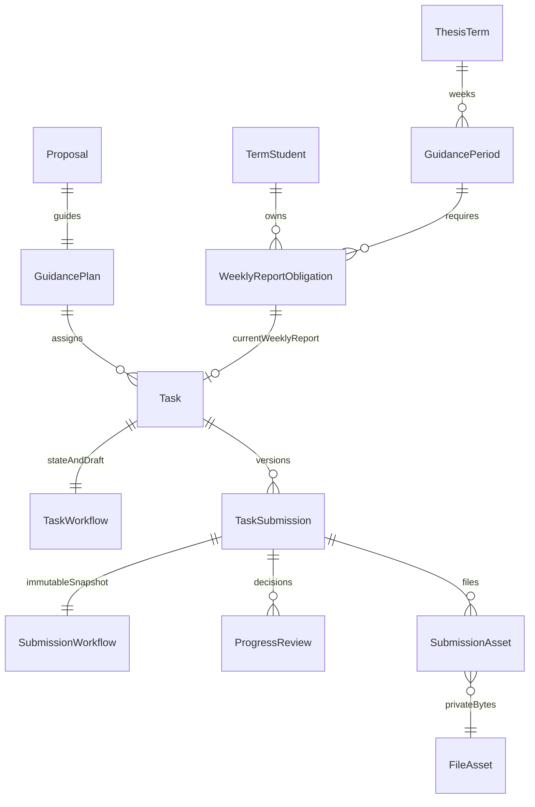

# Bước 8 — khảo sát, thiết kế và kiểm chứng

Khảo sát ngày 04/11/2026, nhánh `fix/integration-ui`, working tree sạch trước triển khai.

## GAP ANALYSIS trước thay đổi

| Chức năng     | Hiện trạng                                                                                 | Thiếu gì                                                         | Cách triển khai                                                 | File ảnh hưởng                                                 | Rủi ro                                                 |
| ------------- | ------------------------------------------------------------------------------------------ | ---------------------------------------------------------------- | --------------------------------------------------------------- | -------------------------------------------------------------- | ------------------------------------------------------ |
| Kế hoạch tuần | Có một phần: GuidancePeriod, PeriodRequiredStudent, WeeklyReportObligation                 | Producer API/UI, công bố, khóa, lịch sử deadline                 | Mở rộng bảng hiện có; khoa có grant toàn đợt quản lý lịch chung | schema, migration, guidance/weekly, weekly-plans               | Không tự công bố dữ liệu legacy                        |
| Giao nhiệm vụ | Có một phần: nhiều AD_HOC/task theo plan và period; lịch sử, ghi chú                       | Tiêu chí, ưu tiên, chặn tuần khóa                                | Bổ sung trường; dùng controller/service hiện có                 | guidance/tasks, shared guidance-tasks, frontend guidance-tasks | Phân công mới phải rebase kế hoạch                     |
| Nộp báo cáo   | Có một phần: staging, phiên bản, snapshot, idempotency                                     | Nháp có persistence; biểu mẫu có cấu trúc; cấm thay bản đang chờ | Mở rộng workflow, giữ TaskSubmission bất biến                   | submissions, shared, frontend task-submissions                 | Không sửa bản nộp lịch sử                              |
| Review        | Đang lỗi so với đặc tả: FAIL và REVISION_REQUIRED cùng cho nộp lại                         | Deadline sửa; mở lại FAIL riêng                                  | Kiểm tra kết quả hiện hành; quyết định mở lại append-only       | reviews, submissions, schema                                   | Giữ enum PASS/FAIL/REVISION_REQUIRED để tương thích    |
| File          | Có một phần: private local, PDF/ZIP, checksum, kiểm chữ ký ZIP/path, sweeper               | Giới hạn theo loại; cảnh báo secret                              | Tái sử dụng storage; policy theo loại                           | submission-policy, validator, UI                               | Chưa có Supabase Storage/malware scanner trong code    |
| Phân quyền    | Có một phần: JWT/session, permission, owner, official FINALIZED advisor, AcademicTermGrant | Áp dụng cho API tuần/nháp/mở lại mới                             | Tái sử dụng policy hiện tại                                     | weekly, submissions, reviews                                   | ADMIN không tự vượt scope học vụ                       |
| Thống kê      | Có một phần: theo task và coverage                                                         | Một dòng SV/tuần, đúng hạn tách kết quả, CSV                     | Dựa trên obligation + current submission                        | weekly service/UI                                              | Không đếm AD_HOC/version thành SV                      |
| Thông báo     | Có một phần: in-app transaction, outbox, scheduler staging                                 | Nhắc hạn và gửi lại độc lập với bài nộp                          | Outbox có khóa dedup + scheduler thực                           | weekly notification worker                                     | Database outage vẫn làm transaction nghiệp vụ thất bại |
| Kiểm thử      | Có một phần: Vitest, scripts API PG17, browser, E2E                                        | Ca mới + chạy lại                                                | Môi trường riêng, không reset DB nhóm                           | tests/scripts                                                  | Chưa tìm thấy Docker/PG17 local lúc khảo sát           |

## Quan hệ và quyết định thiết kế

- Mô hình một SV–một đề tài/đợt giữ qua TopicWorkflow.termStudentId unique. Kế hoạch hướng dẫn liên kết Proposal, bản hồ sơ đã chốt và phân công chính thức FINALIZED; không thay đổi bước 1–7/9–10.
- Báo cáo logic là task WEEKLY_REPORT hiện hành của obligation (unique period/student). AD_HOC là nhiệm vụ riêng. Không tạo bảng báo cáo tuần song song.
- Enum API hiện có PASS/FAIL/REVISION_REQUIRED tương ứng Đạt/Không đạt/Cần sửa. PENDING biểu diễn bởi submission SUBMITTED chưa có effectiveReviewId.
- Tuần mới: DRAFT → OPEN ↔ LOCKED. Công bố tạo nghĩa vụ cho roster; không xóa tuần/bản nộp. Tuần legacy có state null giữ quy trình cũ đến khi khoa cấu hình.
- Deadline lưu timestamptz UTC, nhập/hiển thị Asia/Ho_Chi_Minh. Hạn sửa có thể vượt tuần nhưng phải nằm trong phase GUIDANCE. Tuần khóa chặn thao tác ghi. Chính sách nộp muộn ban đầu cấu hình theo tuần; nộp sửa quá hạn mặc định bị từ chối.
- Khóa thứ tự term → proposal → plan → obligation → task; transaction Serializable, retry xung đột, revision và Idempotency-Key. Mọi API mới kiểm permission và phạm vi từ DB.
- Migration chỉ mở rộng, không xóa hoặc reset dữ liệu. Chỉ áp dụng vào database test riêng trong phiên làm việc; triển khai DB chung cần backup và kiểm migration history/checksum.

## 1. Kiến trúc và nghiệp vụ sau triển khai

NestJS → guards/session + permission → controller/DTO → service/policy → repository → PostgreSQL. React dùng API thật cho toàn bộ các route Bước 8; file đi qua private local storage hiện có. Không có dữ liệu mock trong luồng mới.

Tuần `DRAFT → OPEN ↔ LOCKED`. Báo cáo là một task `WEEKLY_REPORT` của một nghĩa vụ SV/tuần. Nháp không tạo submission. Nộp chính thức tạo version bất biến và chuyển sang chờ review. `REVISION_REQUIRED` cho nộp lại trong hạn sửa, `PASS` chốt task, `FAIL` chỉ được nộp lại sau quyết định mở lại có lý do/hạn mới. Lần nộp mới dùng đủ hai file mới và giữ toàn bộ bản/nhận xét trước.

Notification được ghi vào outbox cùng transaction nghiệp vụ, giao vào bảng notification bằng worker. Lỗi giao không rollback bài đã nộp. Worker chạy mỗi 60 giây, nhắc trước hạn 24 giờ/quá hạn chưa nộp và hạn sửa; khóa chống chạy chồng trong process, khóa hàng `SKIP LOCKED` khi giao và khóa dedup khi nhiều instance chạy.

## 2. Những phần đã có

Đã tái sử dụng kế hoạch hướng dẫn, nhiệm vụ, coverage/obligation, trạng thái phase, điều kiện hồ sơ chốt/đề tài/phân công FINALIZED, session JWT, quyền DB và scope bộ môn; upload staging, checksum/signature PDF/ZIP, cleanup, snapshot file, review append-only và CAS/idempotency. Không tạo hệ thống báo cáo song song hay thay điểm tốt nghiệp/điều kiện bảo vệ.

## 3. Chức năng mới và sửa hành vi

- Khoa tạo, điều chỉnh, công bố, khóa/mở tuần; đồng bộ nghĩa vụ roster và lịch nhiệm vụ tuần; lưu lý do/lịch sử.
- Tiêu chí hoàn thành và ưu tiên nhiệm vụ; chặn ghi khi tuần khóa; cấm hủy báo cáo tuần đã có bài nộp để tránh reset lịch sử.
- Nháp lưu DB với revision riêng; biểu mẫu chín trường, validation từng trường, giải trình bản sửa và cảnh báo rời trang.
- Chặn nộp đè khi chờ review; hạn sửa bắt buộc; chặn nộp sau hạn sửa; chốt PASS/FAIL không sửa bằng form thường; mở lại FAIL bằng quyết định riêng.
- Mặc định PDF 20 MiB, ZIP 100 MiB, minh chứng 20 MiB/file, tổng 140 MiB; cấu hình tập trung và snapshot policy `weekly-20261104-v2`.
- Thống kê một SV/tuần, lọc đợt/tuần/SV/GVHD/trạng thái/nộp muộn; CSV có chống công thức; nhãn muộn độc lập với kết quả.
- Transactional outbox và nhắc hạn; JSON report/draft giới hạn riêng 512 KiB để hỗ trợ nội dung tiếng Việt, các route khác giữ hạn cũ.

## 4. File tạo/sửa

Danh sách chính xác nằm ở [changed-files.txt](evidence/weekly-progress/changed-files.txt). Các nhóm chính:

| Nhóm                      | File/thư mục                                                                                                                                          |
| ------------------------- | ----------------------------------------------------------------------------------------------------------------------------------------------------- |
| Schema/migration          | `backend/prisma/schema.prisma`, `backend/prisma/migrations/202611040002_weekly_progress/migration.sql`                                                |
| Tuần, thống kê, worker    | `backend/src/guidance/weekly/*`, `guidance.module.ts`                                                                                                 |
| Nhiệm vụ/nháp/file/review | `backend/src/guidance/{tasks,submissions,reviews}/*`                                                                                                  |
| Contract                  | `shared/src/contracts/{weekly-progress,guidance-tasks,task-submissions,guidance-reviews}.ts`, `shared/src/index.ts`                                   |
| Frontend                  | `features/weekly-plans/*`, `features/task-submissions/*`, `features/guidance-reviews/*`, `features/guidance-tasks/*`, router/manifest                 |
| Test tích hợp             | `backend/scripts/test-weekly-progress.cjs`, `integration/weekly-browser.cjs`, cập nhật `test-guidance-submissions.cjs` và `test-guidance-reviews.cjs` |
| Cấu hình/transport        | `backend/.env.example`, `backend/package.json`, `common/http/body-parsers.ts` và test                                                                 |
| Lint cơ học               | `auth.controller.ts`, `DashboardPage.tsx`, `review-groups/workspace.tsx`: bỏ biến/import không dùng; formatter cũng định dạng lại phần JSX            |

Không sửa service/validator import sinh viên, không push/merge. Các kết quả/PDF sinh tự động của script cũ được lưu riêng trước khi dọn khỏi diff gốc.

## 5. Migration và trạng thái áp dụng

Migration mới chỉ `ADD COLUMN`, `CREATE TABLE`, index, CHECK, FK và trigger append-only cho `GUIDANCE_REOPEN`; không DROP/TRUNCATE/DELETE dữ liệu nghiệp vụ. Các unique student/week, task/version và một review effective đã có từ migration trước.

- **Database test PostgreSQL 17.11:** replay đầy đủ migration chain thành công, bao gồm migration mới; đã chạy API và E2E trên dữ liệu tiền đề thật do script tạo.
- **Database được cấu hình trong backend/.env:** chỉ đọc bằng transaction `READ ONLY`; có 16 migration đã hoàn tất, mới nhất `202611040001_lecturer_quota_policy`, không có GuidancePeriod tại thời điểm đọc. Migration mới **chưa áp dụng** ở database này. Không thay đổi dữ liệu dùng chung.
- Prisma schema đã validate và generate thành công. Do DLL của backend khác đang được dùng, client được generate vào cache rồi cập nhật JS/types; không dừng backend của người dùng.

Triển khai: backup PostgreSQL bằng công cụ được nhóm vận hành phê duyệt và backup private storage cùng thời điểm; chạy `db:inspect`, kiểm lịch sử/checksum, sau đó deploy migration trong maintenance window theo `backend/scripts/shared-database.cjs`. Khởi động backend mới sau khi migrate, kiểm options/week/submit/download và worker. Khi rollback ứng dụng, giữ schema mở rộng và dữ liệu mới; không chạy down migration xóa history. Roll-forward là ưu tiên. Backend cũ có quy tắc PASS/FAIL khác nên không cho ghi đồng thời với backend mới.

## 6. API

Tất cả đường dẫn dưới đây có prefix `/api`, JWT/session thật. API ghi yêu cầu `Idempotency-Key`; cập nhật yêu cầu revision đúng. DTO strict từ chối field lạ. Response dùng envelope `{success,data,timestamp}` hoặc lỗi `{success:false,error:{code,message}}`.

| Method/path                                                | Mục đích                                                                                                         |
| ---------------------------------------------------------- | ---------------------------------------------------------------------------------------------------------------- |
| GET `/weekly-plans/options`                                | Đợt có quyền và khả năng quản lý                                                                                 |
| GET/POST `/terms/:termId/weekly-plans`                     | Danh sách/tạo nháp tuần                                                                                          |
| PATCH `/terms/:termId/weekly-plans/:id`                    | Sửa đầy đủ nội dung/lịch, `expectedRevision`, `reason`                                                           |
| POST `/terms/:termId/weekly-plans/:id/state`               | `OPEN` hoặc `LOCKED`, revision và lý do                                                                          |
| GET `/terms/:termId/weekly-plans/:id/history`              | Lịch sử cấu hình tuần                                                                                            |
| GET `/terms/:termId/weekly-progress`                       | `page`, `limit` ≤100, `periodId`, `studentId`, `advisorId`, `studentSearch`, `advisorSearch`, `status`, `isLate` |
| GET `/terms/:termId/weekly-report-coverage`                | Bao gồm cả nghĩa vụ chưa có task                                                                                 |
| POST `/weekly-report-obligations/:id/task`                 | Materialize báo cáo tuần theo kế hoạch hợp lệ                                                                    |
| GET/POST `/guidance-plans/:id/tasks`                       | API nhiệm vụ hiện có                                                                                             |
| GET/PATCH `/tasks/:id`                                     | Xem/sửa nhiệm vụ; thêm criteria/priority                                                                         |
| PUT `/tasks/:taskId/draft`                                 | `expectedDraftRevision`, `report` từng phần, `content`, `changeExplanation`                                      |
| GET `/tasks/:taskId/submission-context`                    | Quyền nộp, draft của chủ sở hữu, policy, deadline hiệu lực                                                       |
| POST `/tasks/:taskId/submission-uploads`                   | Multipart `kind` + `file` → staging ID                                                                           |
| GET/POST `/tasks/:taskId/submissions`                      | Lịch sử/nộp version; `expectedTaskRevision`, `uploadIds`, `report`, `changeExplanation`                          |
| GET `/task-submissions/:id`                                | Đọc snapshot một version                                                                                         |
| GET `/task-submissions/:id/files/:fileId/download`         | Download có xác thực, không lộ storage key                                                                       |
| GET `/terms/:termId/progress-review-inbox`                 | Inbox GVHD                                                                                                       |
| GET `/task-submissions/:id/review-context`                 | Bản nộp, lịch sử và thao tác được phép                                                                           |
| POST `/task-submissions/:id/reviews`                       | `PASS/FAIL/REVISION_REQUIRED`, comment, revision và hạn sửa khi cần                                              |
| POST `/task-reviews/:id/amendments`                        | Correction có lý do cho quyết định chưa chốt                                                                     |
| POST `/task-submissions/:id/reopen`                        | Mở lại FAIL: `expectedTaskRevision`, `reason`, `revisionDueAt`                                                   |
| GET `/me/notifications`; POST `/me/notifications/:id/read` | Thông báo chỉ của người đăng nhập                                                                                |

Lỗi quan trọng: 400 DTO/file/date; 401 session; 403 vai trò/thao tác; 404 ngoài scope; 409 stale revision/trạng thái/deadline/storage chưa sẵn sàng; 413 multipart/JSON vượt hạn. Không trả nội dung file hoặc URL bí mật trong lỗi.

## 7. Màn hình

| Route                                          | Người dùng/chức năng                                                                  |
| ---------------------------------------------- | ------------------------------------------------------------------------------------- |
| `/guidance/weeks?termId=...`                   | Ba vai trò: tuần và trạng thái theo scope; khoa có form cấu hình, history, lọc và CSV |
| `/guidance/plan`, `/guidance/plan/:proposalId` | Kế hoạch và nhiệm vụ theo hồ sơ hợp lệ                                                |
| `/guidance/plan/:proposalId/tasks/new`         | GVHD giao việc, tiêu chí/ưu tiên/mốc/hạn                                              |
| `/guidance/tasks?termId=...`                   | Nhiệm vụ + coverage, tạo task báo cáo còn thiếu                                       |
| `/guidance/tasks/:id/submissions`              | Thông tin SV/đề tài/GVHD/đợt, nháp, upload, nộp, lịch sử/download                     |
| `/guidance/review/:submissionId`               | Nội dung structured, file, timeline nhận xét, đánh giá/hạn sửa/mở lại                 |
| Màn hình inbox/dashboard/notifications hiện có | Kết nối kết quả và sự kiện thực                                                       |

## 8. Ma trận quyền

| Thao tác                        | Sinh viên        | GVHD hiện hành                                          | Khoa có grant                         | ADMIN đơn thuần     |
| ------------------------------- | ---------------- | ------------------------------------------------------- | ------------------------------------- | ------------------- |
| Xem lịch công bố                | Đợt trong roster | Đợt trong roster                                        | Đợt được cấp                          | Không tự vượt scope |
| Tạo/sửa/công bố/khóa tuần chung | Không            | Không                                                   | `allDepartments` + permission monitor | Không               |
| Giao/sửa nhiệm vụ               | Không            | Đúng SV có phân công FINALIZED, hồ sơ chốt, plan active | Không thay GVHD                       | Không               |
| Nháp/nộp/upload                 | Chính mình       | Không                                                   | Không                                 | Không               |
| Xem/download báo cáo            | Chính mình       | Đúng phân công hiện hành                                | Đúng đợt/bộ môn được cấp              | Không               |
| Review/mở lại FAIL              | Không            | Đúng phân công hiện hành + permission review            | Không thay GVHD                       | Không               |
| Xem thống kê                    | Chính mình       | SV hướng dẫn hiện hành                                  | Đúng scope                            | Không               |
| Xem nháp của SV khác            | Không            | Không                                                   | Không                                 | Không               |

GVHD cũ mất quyền học vụ sau handover; GVHD mới phải có dữ liệu đề tài/plan đã rebase theo policy trước đó. JWT claims không tự cấp quyền. Tuần/phase/term khóa chặn ghi ở backend, dù gọi API trực tiếp.

## 9. Luồng đã kiểm thử

Trình duyệt Edge headless dùng ba context đăng nhập độc lập, Vite + Nest + PG17 + filesystem private, không intercept/mock API: khoa tạo/công bố tuần → GVHD giao task → SV materialize báo cáo tuần → điền/lưu nháp → reload còn nháp → tải PDF+ZIP → nộp v1 → GVHD yêu cầu sửa có hạn → SV nộp v2 có giải trình → GVHD PASS → SV chỉ xem → khoa lọc tuần thấy đúng một PASS. Kiểm số submission/review trong DB, lỗi JS không bắt và HTTP 5xx; chụp hai màn hình cuối.

API bổ sung đủ ba quyết định, FAIL/reopen/v3 PASS, correction deadline có lịch sử, hết hạn sửa, nộp muộn có/không cho phép, snapshot deadline sau điều chỉnh, chống hủy để reset version, đọc chéo, concurrency, file lỗi/mất, outbox thất bại rồi retry, nhắc hạn dedup. Hồi quy 8B/8C thêm rollback audit/metadata, cleanup file mồ côi, phase closure race và review-versus-resubmit race.

## 10. Test đã chạy

| Lệnh/bộ kiểm tra                                                     | Kết quả thực tế                                                                                                     |
| -------------------------------------------------------------------- | ------------------------------------------------------------------------------------------------------------------- |
| `pnpm type-check`                                                    | Đạt backend/frontend/shared                                                                                         |
| `pnpm lint`                                                          | Đạt backend/frontend                                                                                                |
| `pnpm build`                                                         | Đạt; Vite vẫn cảnh báo chunk >500 kB và CJS deprecation                                                             |
| Prisma validate + generate                                           | Đạt, dùng engine cache đã có                                                                                        |
| `pnpm test`                                                          | Frontend **156 passed, 0 failed** (31 file); backend **331 passed, 2 failed** (34 file). Toàn lệnh **FAIL**         |
| `pnpm --filter @doan/backend test:weekly:api`, `WEEKLY_BROWSER=true` | **11 nhóm kiểm tra đạt**, gồm E2E thật; [integration.json](evidence/weekly-progress/integration.json)               |
| `test:guidance-tasks:api` (cả lượt riêng và prelude)                 | **19 nhóm đạt**                                                                                                     |
| `test:guidance-reviews:api` (bao gồm prelude submissions)            | **17 nhóm 8B + 18 nhóm 8C đạt**                                                                                     |
| Prelude hồ sơ/phản biện                                              | **21 nhóm bước 7 + 28 nhóm bước 5 đạt**, chạy qua chuỗi producer của 8A; không tuyên bố đã chạy mọi suite bước 1–10 |
| Đọc DB dùng chung                                                    | READ ONLY thành công, không DDL/DML                                                                                 |

Hai test fail là `backend/src/catalog/service/existing-profiles.spec.ts`: legacy CREATE preview cho SV chưa tồn tại ở STRICT và VALID_ONLY được service chấp nhận trong khi test yêu cầu từ chối. File service/validator/test này không đổi trong lần triển khai; cần quyết định riêng về nghiệp vụ import. Không xóa test, tắt validation hay sửa expectation để báo xanh.

Trong phiên này lệnh thực thi API là `node .cache/run-weekly.cjs` và `node .cache/run-weekly.cjs test-guidance-reviews.cjs`; wrapper chỉ cấp URL/psql/engine cho database loopback do helper tạo. Cách chạy tái lập không cần cache nằm ở mục 14. Số ở bảng là nhóm scenario của script, không phải số assertion.

## 11. Lỗi đã sửa và cách tái hiện

| Trước                                               | Tái hiện                              | Sau                                                       |
| --------------------------------------------------- | ------------------------------------- | --------------------------------------------------------- |
| Nộp version mới khi đang chờ review                 | Nộp lần 1 rồi upload/nộp tiếp         | 409, giữ bản hiện tại                                     |
| FAIL có thể nộp lại trực tiếp                       | Chọn Không đạt rồi nộp tiếp           | Phải mở lại riêng, có lý do/hạn/audit                     |
| Thiếu hạn sửa                                       | Chọn Cần sửa không nhập hạn           | 400; UI đánh dấu bắt buộc                                 |
| Đánh giá PASS rồi amendment đổi kết quả             | Gửi amendment trên PASS               | 409, lịch sử giữ nguyên                                   |
| Hủy task tuần có bài để tạo lại từ v1               | Cancel WEEKLY_REPORT đã có submission | 409, không reset logic report                             |
| Nội dung tiếng Việt lớn bị JSON parser chặn quá sớm | Gửi >100 KiB nhưng trong DTO          | Route report/draft nhận đến512 KiB; route khác giữ100 KiB |
| Notification ID hash vượt varchar36                 | Giao event kế hoạch không có ID sẵn   | Deterministic ID32 ký tự; giao lại không trùng            |
| Validation UI báo chung                             | Bỏ trống trường bắt buộc              | Thông báo tại trường sau blur                             |

## 12. Phần chưa hoàn thiện / chưa xác minh

- Toàn bộ unit suite chưa xanh vì hai test import nêu trên. Chưa chứng nhận toàn hệ thống bước 1–10 không có regression.
- Chưa mô phỏng mất mạng thật giữa stream upload, DB ngắt kết nối hoặc cạn connection pool dùng chung; đã kiểm lỗi storage/metadata/audit và transaction rollback trên test DB.
- Chưa benchmark dữ liệu lớn. Summary hiện có phân trang response nhưng lọc/ghép các nghĩa vụ trong transaction và có nhiều query; cần tối ưu truy vấn tổng hợp trước đợt rất lớn. Chưa stress100 MiB bằng browser; giới hạn byte có unit/HTTP multipart test.
- Storage là private local hiện có; không triển khai Supabase Storage hay malware scanner. Cần volume bền vững/backup khi deploy; chưa có kết quả quét malware để công bố.
- UI nháp lưu nội dung; file chọn/staging trong phiên trình duyệt. Reload phải chọn lại file. CSV hỗ trợ, chưa thêm XLSX.
- Đã áp dụng migration Bước 8 trên database development dùng chung ngày 05/11/2026; xem cập nhật triển khai bên dưới. Không dừng ứng dụng đang chạy.

## 13. Giả định nghiệp vụ được dùng

- Lịch tuần chung thuộc khoa có grant toàn đợt; khoa theo bộ môn chỉ đọc báo cáo trong scope. ADMIN kỹ thuật không thay khoa/GVHD.
- PDF là báo cáo, ZIP là mã nguồn; tên enum cũ `SOURCE` tương đương SOURCE_CODE. DOC/DOCX chỉ là đề xuất trong yêu cầu, chưa mở định dạng không có validator.
- Cho phép muộn lần đầu theo `allowLate`, mặc định true; không nhận sau hạn sửa. Hạn sửa có thể vượt tuần nhưng phải trước khi phase GUIDANCE kết thúc.
- PASS không mở lại trong phạm vi này. FAIL mở lại tối đa một lần cho mỗi version; FAIL của version sau có quyết định mới.
- Nhận xét bắt buộc cho FAIL/REVISION_REQUIRED, PASS tùy chọn theo contract cũ. Một tuần/một SV/một đề tài logic, không có nhóm SV.
- Tuần legacy state null giữ tương thích; không tự công bố hoặc tự khóa dữ liệu cũ. Công bố lại bổ sung SV mới vào roster; không xóa nghĩa vụ/lịch sử cũ.

## 14. Hướng dẫn chạy và kiểm thử thủ công

1. Cài dependency theo lockfile; cấu hình `backend/.env` và frontend API theo mẫu, tuyệt đối không đưa DB URL vào `VITE_*`. Đọc `backend/.env.example` cho upload/worker. Root `.env.example` chỉ dành Docker interpolation.
2. Generate client với `pnpm --filter @doan/backend db:generate`. Dùng database development đã được migrate đúng chain; `pnpm build`, `pnpm type-check`, `pnpm lint`, `pnpm test`.
3. Với test tích hợp, tạo **database PostgreSQL17 mới, trống, loopback**, tên `btl_pr2b_*`. Cấp `PR2B_TEST_URL` qua môi trường riêng và `PR2B_PSQL` là đường dẫn psql17. Không đưa URL thật vào tài liệu/shell history được chia sẻ.
4. `pnpm --filter @doan/backend test:weekly:api`; muốn browser đặt `WEEKLY_BROWSER=true`, cài Edge và để trống port50186. Script tự chạy producer/migration trên DB trống, API port ngẫu nhiên, storage thư mục test riêng; không dùng tài khoản production. Rerun mặc định cần database test mới. `WEEKLY_USE_PREPARED=true` chỉ cho fixture đã tạo, session/thời hạn fixture có tuổi thọ hữu hạn.
5. Chạy hồi quy storage/review trên **một DB test mới khác** bằng `pnpm --filter @doan/backend test:guidance-reviews:api`. Các script không reset/drop DB. Không chạy song song trên cùng database.
6. Kiểm thủ công: khoa mở `/guidance/weeks`, chọn đợt có phase GUIDANCE; tạo/công bố tuần. GVHD mở hồ sơ đã chốt và giao nhiệm vụ; SV mở danh sách task, tạo task báo cáo tuần, lưu nháp và reload; chọn PDF/ZIP, nộp; GVHD chọn Cần sửa và hạn; SV nộp lại có giải trình; GVHD Đạt. Lặp với Không đạt/mở lại. Thử tuần khóa, thiếu file và account khác. Kiểm khoa CSV, notification sau ≤60 giây.
7. Kiểm lịch sử sau gia hạn: bản cũ giữ deadlineSnapshot/isLate; bản mới tính hạn có hiệu lực. Kiểm version cũ không có form review và không đổi bytes.

## 15. Rủi ro tích hợp và 35 trường hợp biên

Backend mới phải đi cùng migration/contract mới. Không chạy worker mới trước migrate. Cấu hình `GUIDANCE_REMINDERS_ENABLED=false` dừng cả giao outbox và nhắc hạn; chỉ dùng khi kiểm thử/maintenance. Bài ghi thành công sẽ chờ giao khi bật lại. Giới hạn reverse proxy phải phù hợp giới hạn multipart backend. Snapshot deadline/policy/file không được sửa hồi tố.

Ký hiệu: **U** unit đã chạy, **W** API tuần đã chạy, **B** API8B đã chạy, **C** API8C đã chạy, **A** API8A đã chạy, **E** browser đã chạy, **P** thiết kế có nhưng chưa giả lập đầy đủ.

| #     | Trường hợp                           | Backend mong đợi / frontend                                | Bằng chứng                               |
| ----- | ------------------------------------ | ---------------------------------------------------------- | ---------------------------------------- |
| 1–3   | Chưa có GVHD FINALIZED/đề tài hợp lệ | Chặn ghi, readiness hướng dẫn đối soát                     | A/U                                      |
| 4     | Đợt/phase chưa mở                    | 409, màn hình chỉ đọc                                      | A/U                                      |
| 5     | Tuần nháp                            | Không lộ cho SV, không ghi                                 | W/U                                      |
| 6     | Tuần khóa                            | Chặn task/upload/nộp/review; vẫn đọc lịch sử               | W/U                                      |
| 7     | Deadline qua, không cho muộn         | 409, nút nộp không hiện                                    | W                                        |
| 8     | Đúng sát deadline                    | Dấu `>`: bằng hạn là đúng hạn                              | U                                        |
| 9     | Nộp muộn được phép                   | Ghi isLate độc lập kết quả, UI nhãn muộn                   | W/B                                      |
| 10    | Chưa có task tuần                    | Coverage vẫn thiếu; tạo task idempotent                    | A/W/E                                    |
| 11–12 | Thiếu report/source                  | Không tạo version, hiện lỗi                                | W/B/U                                    |
| 13    | File đủ, submit DB lỗi               | Rollback pointer/version/link; giữ staging retry           | B                                        |
| 14    | File thứ hai lỗi                     | Không nộp thiếu file; giữ file đầu staging                 | W/B, UI giữ selection                    |
| 15    | Mất mạng khi upload                  | Intent/TTL cleanup, UI giữ form và retry                   | P: chưa ngắt mạng thật                   |
| 16    | Double submit                        | Một version, replay hoặc409                                | W/B                                      |
| 17–18 | Review và resubmit đồng thời         | Khóa cùng task, một chuyển trạng thái hợp lệ               | C                                        |
| 19    | Yêu cầu sửa/correction nhiều lần     | Lịch sử append-only và một effective result                | W/C; vòng nhiều version đã kiểm v1→v2→v3 |
| 20    | Nộp quá hạn sửa                      | 409 cả direct upload, UI chỉ xem; correction phải có lý do | W                                        |
| 21    | PASS rồi sửa/chấm lại                | Từ chối, giữ kết quả                                       | C/W/E                                    |
| 22    | FAIL rồi mở lại                      | Permission + lý do + hạn + quyết định bất biến             | W                                        |
| 23    | Đổi GVHD                             | GV cũ mất quyền; GV mới cần rebase                         | A/B/C                                    |
| 24    | Gia hạn sau khi nộp                  | Audit trước/sau, snapshot cũ không đổi                     | W                                        |
| 25    | GV khác truy cập/chấm                | 404 ngoài phạm vi, không lộ bài                            | B/C/W                                    |
| 26    | Mất object storage                   | 409 FILE_NOT_READY, không xóa metadata                     | W                                        |
| 27    | Bytes ghi rồi DB lỗi                 | Bù trừ xóa orphan; intent cleanup còn lại                  | B                                        |
| 28    | DB đứt kết nối                       | Không báo thành công; transaction/IO bù trừ                | P: chưa ngắt DB thật                     |
| 29    | Pool dùng chung quá tải              | Lỗi có kiểm soát, retry hữu hạn, cần capacity test         | P                                        |
| 30    | Một SV nhiều đợt                     | Scope theo term/termStudent, không lấy đợt tùy ý           | A/B/C; P cho fixture cùng SV nhiều năm   |
| 31    | Trùng số tuần khác đợt               | Unique(termId,ordinal) cho phép                            | Schema; P cho thao tác UI hai đợt        |
| 32    | Tuần cuối không có tuần tiếp         | Không tự tạo/không giả định tồn tại tuần kế                | P: kiểm thủ công                         |
| 33    | Không có dữ liệu                     | Metrics0, empty state, pagination an toàn                  | U/E                                      |
| 34    | UTC+7 lệch ngày                      | Offset bắt buộc; roundtrip và ranh giới nửa đêm            | U/W/E                                    |
| 35    | Retry sau gián đoạn                  | Idempotency hash + CAS, không trùng version/notif          | W/B/C; chưa ngắt TCP thật                |

## 16. Definition of Done

- [x] Khoa quản lý tuần; GVHD giao việc; SV thấy đúng nhiệm vụ.
- [x] Nháp DB; hai file bắt buộc; validation backend; deadline và phiên bản bất biến.
- [x] Ba kết quả; hạn sửa; resubmit; mở lại FAIL; lịch sử không mất.
- [x] Scope owner/current advisor/faculty, concurrency submit/review, nhiệm vụ tuần tiếp theo qua kế hoạch.
- [x] Thống kê một SV/tuần, CSV, transactional notification và scheduler thật.
- [x] Backend/frontend/database/storage thật trong E2E; lint/type-check/build đạt.
- [x] Migration mở rộng, không destructive DDL; tài liệu API/database/chạy/test; chưa push/merge.
- [ ] Toàn bộ test repo xanh: còn2 lỗi import sinh viên ngoài phạm vi.
- [ ] Chứng nhận đủ35 tình huống trên môi trường vận hành và toàn bộ regression bước1–10: các mục P chưa thực hiện.
- [ ] Nghiệm thu đầy đủ trên môi trường dùng chung: migration đã áp dụng và truy vấn context đã kiểm tra ngày 05/11/2026; chưa nghiệm thu toàn bộ thao tác bằng trình duyệt.

**Kết luận nghiệm thu:** chức năng cốt lõi Bước 8 đã triển khai và chạy đạt trên môi trường test riêng. Chưa tuyên bố Definition of Done toàn hệ thống hoàn tất hoặc toàn bộ test PASS.

### Cập nhật triển khai development ngày 05/11/2026

Lỗi “Không thể xử lý yêu cầu” tại Kế hoạch hướng dẫn xuất phát từ Prisma P2022: database thiếu cột `GUIDANCE_PERIOD.description` vì chưa áp dụng `202611040002_weekly_progress`. Đã sao lưu schema `public` và dữ liệu ứng dụng bằng `pg_dump`, kiểm tra archive đọc được, đối chiếu lịch sử/checksum migration rồi áp dụng đúng migration còn thiếu. Không reset database.

- Backup cục bộ: `.cache/weekly-deploy-2026-11-05T03-01-32-949Z/public-before-weekly.dump` (468145 byte); không đưa backup dữ liệu vào Git.
- Lịch sử migration sau triển khai không còn migration chờ áp dụng. Đọc thành công GuidancePeriod, TaskWorkflow, SubmissionWorkflow, ProgressReview và GuidanceReopen.
- Kiểm tra bằng kết nối runtime lúc 10:05 giờ Việt Nam: `GuidanceService.context()` thành công cho cả hai hồ sơ hiện có trong transaction chỉ đọc; endpoint tài liệu backend trả HTTP 200. Chưa kiểm tra phiên đăng nhập người dùng qua trình duyệt.
- Số lượng bản ghi ở bảy bảng đối chiếu không đổi: 20 tài khoản, 2 hồ sơ; kế hoạch, nhiệm vụ, bài nộp, tuần và đánh giá tiến độ đều chưa có bản ghi. Hai hồ sơ chưa có phase GUIDANCE; cần cấu hình nghiệp vụ trước khi thực hiện hướng dẫn.
- Bằng chứng triển khai và kiểm tra runtime lưu cùng thư mục backup trong `deployment-result.json` và `runtime-verification.json`. Các kết quả test riêng ở phần trên giữ nguyên phạm vi xác minh ban đầu.
