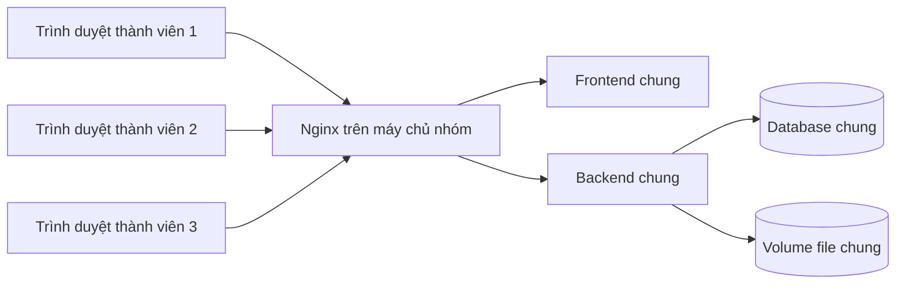

# Một môi trường tích hợp chung cho cả nhóm

> **Lựa chọn mới nhất ngày 29/10/2026:** Windows chạy NestJS, Supabase PostgreSQL và Supabase Storage private. Xem [đề xuất cập nhật, đang chờ xác nhận](windows-supabase-shared-proposal.md). Compose/volume uploads bên dưới là phương án trước đó, không phải cấu hình được chọn để triển khai hiện tại. Chưa thực hiện migration, seed hay bật chia sẻ mạng.

Ngày 29/10/2026. Lựa chọn của nhóm: một backend, một database và một kho file chung. Cấu hình chạy nằm ở `compose.shared.yml`. Đây là môi trường tích hợp nội bộ, frontend vẫn dùng Vite dev server; chưa phải bản triển khai production/public Internet.

## Vì sao dữ liệu hiện tại khác nhau?

`pnpm ui:dev` dùng `scripts/integration-ui.cjs`: script ghi đè DATABASE_URL/DIRECT_URL bằng PostgreSQL riêng tại `127.0.0.1:55451/btl_integration_ui`. Mỗi máy có `.cache/integration-ui/data` riêng, Git không đồng bộ dữ liệu này. Pull code không pull database, tài khoản, file upload hay trạng thái nghiệp vụ.

Chỉ trỏ nhiều backend vào cùng database vẫn có lỗi: bài nộp được lưu qua STORAGE_LOCAL_PATH, máy khác không có file đó; cấu hình JWT khác nhau cũng làm token không dùng qua lại được. Mô hình thống nhất:



## Chuẩn bị một lần trên máy chủ nhóm

1. Chọn máy luôn bật mà cả nhóm truy cập được qua LAN/VPN, có Node 20+, pnpm 9+ và Docker Compose. Lấy IP hoặc tên DNS của máy đó. `localhost` trên máy thành viên là máy thành viên, không phải máy chủ.
2. Chọn database tích hợp riêng. Có thể dùng Supabase hiện có **sau khi đối soát dữ liệu và migration**. Không trộn các DB local bằng cách chép đè hoặc chạy tất cả seed. Nếu muốn giữ dữ liệu, chỉ định một nguồn chính, backup và lập phương án chuyển dữ liệu/file trước.
3. Checkout cùng commit đã thống nhất. Cài dependency bằng `pnpm install --frozen-lockfile` trên máy thực hiện kiểm tra Prisma.
4. Tạo `backend/.env` từ `backend/.env.example` nếu chưa có. Điền DATABASE_URL, DIRECT_URL, DB_INSPECT_HOST bằng thông tin thật của database chung; giữ bí mật ngoài Git. Với Supabase, sao chép URL từ Dashboard → Connect, dùng TLS; không tự đoán hostname. DIRECT_URL dùng kết nối direct/session phù hợp kiểm tra migration.
5. Đặt JWT_SECRET và JWT_REFRESH_SECRET riêng cho server chung. Đặt FRONTEND_URL bằng origin người dùng thực sự mở, ví dụ `http://192.168.1.10:8080`. Các địa chỉ sau đây chỉ là ví dụ, thay bằng máy của nhóm.
6. Backup database và file nguồn nếu chuyển từ môi trường đã có dữ liệu. Tất cả file của một DB phải đi cùng bản backup DB đó. Không chép `.cache` chứa credential vào Git.

## Kiểm tra database trước khi chạy

Tại thư mục gốc, trong terminal mới không kế thừa DATABASE_URL/DIRECT_URL từ môi trường test:

```powershell
pnpm --filter @doan/backend prisma generate
pnpm --filter @doan/backend db:inspect
```

Đối chiếu bảng, lịch sử migration, checksum và dữ liệu hiện có với `backend/prisma/migrations`. `db:inspect` chỉ đọc. Nếu có bảng nhưng không có Prisma history, dừng để đối soát baseline; không `db push`, reset hoặc đánh dấu migration đã chạy theo phỏng đoán.

Người quản lý DB thực hiện migration sau backup và duyệt SQL/đích cụ thể theo [hướng dẫn Supabase](02b-supabase-configuration.md). `db:deploy` có gate `ALLOW_DATABASE_MIGRATION` và `--target`; không đưa lệnh bỏ gate vào quy trình chạy của mỗi thành viên. Seed tài khoản/quyền ban đầu cũng do một người quản lý, sau khi kiểm tra script. Các script `ui:sample`/`ui:workflow` phục vụ DB UI local, không phải công cụ chuẩn bị DB chung.

## Khởi động trên server sau khi DB đã sẵn sàng

```powershell
docker compose -p btl-shared -f compose.shared.yml up -d --build
docker compose -p btl-shared -f compose.shared.yml ps
docker compose -p btl-shared -f compose.shared.yml logs --tail 100 backend
```

Mở `http://IP-MAY-CHU:8080`. Frontend gọi `/api` cùng origin qua Nginx; không nhúng `localhost:3000` vào trình duyệt thành viên. Database lấy từ `backend/.env`; compose không tạo DB local, không migrate, không seed. Backend chạy bản build, không mount source Windows lên image. PDF/bài nộp lưu tại volume `btl-shared_shared_uploads`. EMAIL_WORKER_ENABLED bị tắt cho môi trường tích hợp để thử chức năng không tự gửi email thật.

Chỉ công bố cổng 8080 trong mạng nhóm. Không công bố cổng DB cho các máy thành viên. Máy chủ cần cho phép kết nối cổng 8080 từ LAN/VPN theo cấu hình mạng của nhóm. Nếu thay cổng, đặt TEAM_HTTP_PORT trong shell và cập nhật FRONTEND_URL tương ứng.

## Cách mỗi thành viên sử dụng

1. Dùng cùng link máy chủ và tài khoản riêng do quản trị cấp; không cần chạy backend/DB local để xem môi trường chung.
2. Chọn cùng đợt đồ án. Dùng các tài khoản khác nhau khi kiểm tra nhiều vai trò; nhiều tab cùng trình duyệt có thể mang phiên đăng nhập khác nhau tùy cách mở tab.
3. Người A lưu một thay đổi thử được thống nhất; người B tải lại và kiểm tra cùng mã hồ sơ/đợt. Kiểm tra cả tải PDF và tải bài nộp từ máy B để xác nhận kho file cũng dùng chung.
4. Khi phát triển code, vẫn dùng DB local/test riêng. Chỉ bản code đã thống nhất mới được cập nhật lên server tích hợp. Không chạy suite fixture/reset trên DB chung.

Mật khẩu `Demo@2026` và các tài khoản `sv001`, `gv001` trong hướng dẫn UI local chỉ tồn tại nếu DB đó đã được chuẩn bị; không mặc định DB chung có cùng tài khoản/dữ liệu.

## Cập nhật và backup

Trên server: kiểm tra working tree, pull đúng nhánh/commit, review migration mới, backup DB và volume file; nếu cần thì người quản lý chạy migration đã duyệt; sau đó chạy lại lệnh compose `up -d --build`. Kiểm tra đăng nhập, hai máy nhìn cùng hồ sơ và tải được file. Không dùng `down -v`: tùy chọn này xóa volume upload. Để dừng mà giữ file:

```powershell
docker compose -p btl-shared -f compose.shared.yml down
```

Không đồng nhất “đã push code” với “đã deploy server”. Ghi lại commit server đang chạy trong nhật ký nhóm. Backup DB và uploads theo cùng mốc thời gian; thử khôi phục trên môi trường riêng trước khi cần phục hồi thật.

## Giới hạn xác minh của lần thay đổi này

Nhóm đã chọn Supabase **Project1**, project ref `zlsygwjskvxgtzdjhvzt`, region `ap-northeast-1`. Cấu hình DATABASE_URL và DIRECT_URL hiện có trong backend/.env khớp project này, dùng session pooler cổng 5432. Kiểm tra READ ONLY ngày 29/10/2026 đã kết nối thành công: PostgreSQL 17.11, không có bảng/cột/constraint trong public và không có `_prisma_migrations`; 39 bảng quan sát được thuộc auth/realtime/storage/vault. Không đọc nội dung các bảng hệ thống. Đây chưa phải database ứng dụng đã sẵn sàng.

Chưa chọn máy chạy backend/kho file hoặc nguồn dữ liệu khởi tạo. Chưa chuyển dữ liệu, thay credential, chạy migration/seed hay deploy lên DB chung. Máy làm việc hiện tại không có Docker trên PATH, nên compose mới chưa được chạy thực tế. Các bước xác nhận hai máy và tải file là tiêu chí nghiệm thu sau khi chọn server. Không dùng việc kết nối inspect thành công để kết luận ứng dụng đã chuyển sang Supabase: backend UI đang chạy vẫn dùng DB local riêng.
