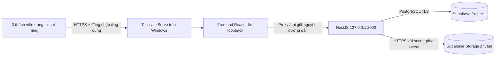

# Đề xuất kiểm thử chung: Windows + Supabase PostgreSQL + Supabase Storage

Ngày 29/10/2026. Trạng thái: **đề xuất chờ xác nhận**, không phải môi trường đã triển khai. Theo yêu cầu mới nhất: chỉ kiểm tra và đề xuất; chưa thay database, migrate, seed, tạo bucket, cấu hình VPN, firewall hoặc công bố backend.

## 1. Cấu hình thực tế đã kiểm tra

| Thành phần | Hiện trạng | Việc cần làm |
| --- | --- | --- |
| Database trong backend/.env | DATABASE_URL và DIRECT_URL khớp Project1 `zlsygwjskvxgtzdjhvzt`, session pooler ap-northeast-1:5432, sslmode=require | Giữ URL bí mật trên máy chủ; dùng cấu hình riêng cho tích hợp |
| Supabase schema | Lần inspect READ ONLY trước đó kết nối được; public chưa có bảng ứng dụng hoặc Prisma history | Review 13 migration hiện có, kiểm tra lại đích và backup trước khi xin phép áp dụng |
| Backend UI đang chạy | Cổng 3000; launcher UI truyền DB local thay cho backend/.env | Không dùng ui:dev/ui:prepare để chạy môi trường Supabase |
| NestJS listener | `app.listen(port)` chưa chỉ rõ loopback | Thêm cấu hình host và bind 127.0.0.1 khi vận hành sau reverse proxy |
| CORS | backend/.env hiện chỉ có http://localhost:5173 | Dùng origin HTTPS chính xác của môi trường chung; không wildcard |
| Frontend | Vite bind 127.0.0.1:5173, proxy /api đến localhost:3000; .env.local hiện trỏ API local | Dùng VITE_API_URL=/api và hostname riêng được cho phép; không đổi cấu hình local đang thử |
| File báo cáo/source | FileStorageService.savePrivateGuidance/readPrivateGuidance/deletePrivateGuidance dùng fs dưới STORAGE_LOCAL_PATH | Thêm adapter Supabase Storage, không fallback local trong chế độ tích hợp |
| PDF hồ sơ | Dossier service dùng FileAsset.storageKey dạng db:dossier-pdf và DossierPdfContent.bytes | Chuyển đường ghi/đọc PDF sang Storage nếu yêu cầu toàn bộ file ở Storage; giữ snapshot/hash nghiệp vụ trong PostgreSQL |
| Key Storage | Backend env hiện chỉ có STORAGE_LOCAL_PATH/STORAGE_MAX_SIZE_MB, chưa có cấu hình Supabase Storage | Cần secret phía backend, không đưa qua chat hoặc VITE_* |
| Công cụ chia sẻ | Chưa thấy tailscale/cloudflared trên PATH | Cần cài/đăng nhập và xác nhận cấu hình truy cập trước khi bật |

Không suy rằng backend cổng 3000 đã dùng Supabase chỉ vì backend/.env có URL Supabase: process environment của launcher local có ưu tiên cao hơn.

## 2. Kiến trúc đề xuất



Mọi người mở cùng URL HTTPS của máy Windows và cùng frontend/commit. Frontend dùng `/api`; proxy trên máy chủ chuyển request đến NestJS. Trình duyệt thành viên không gọi `localhost:3000` trên máy của họ. Khi chuyển sang VPS, giữ database, bucket, object key và API; chỉ chuyển chương trình, secret và reverse proxy.

Tailscale Personal hiện cho phép 6 người dùng miễn phí, phù hợp quy mô nhóm 3 người nếu thuộc phạm vi sử dụng của gói. Tailscale Serve cung cấp dịch vụ trong tailnet và áp dụng access control; không dùng Funnel hoặc port forwarding router. Nguồn: [pricing](https://tailscale.com/pricing), [Serve](https://tailscale.com/docs/features/tailscale-serve).

Tạo access rule chỉ cho ba tài khoản nhóm truy cập máy chủ cổng HTTPS 443; bỏ quyền rộng không cần thiết theo policy hiện có. VPN chỉ giới hạn người có thể kết nối, còn đăng nhập JWT, role, permission, grant và owner vẫn do NestJS kiểm tra. Không tin các header nhận dạng proxy để tự cấp vai trò học vụ.

## 3. Frontend và truy cập Windows

Giai đoạn tích hợp: build React từ commit thống nhất, chạy một preview server chỉ bind loopback, proxy `/api` tới NestJS; cấu hình hostname được phép bằng tên tailnet cụ thể. Preview chỉ phục vụ kiểm thử nội bộ, không dùng làm máy chủ production. Khi sang VPS, dùng static server/reverse proxy phục vụ dist với SPA fallback và `/api` tới NestJS.

Đây là cấu hình mục tiêu, cần chuẩn bị trong code/env sau xác nhận:

```text
React API base: /api
Frontend preview: http://127.0.0.1:4173
Proxy /api: http://127.0.0.1:3000 (giữ /api)
NestJS host/port: 127.0.0.1:3000
Origin chung: https://TEN-MAY.TEN-TAILNET.ts.net
```

Sau khi cài, đăng nhập VPN, kiểm tra access rule và được phép bật chia sẻ, lệnh dự kiến là `tailscale serve --bg http://127.0.0.1:4173`. Lệnh này chưa được thực thi. Kiểm tra trạng thái và URL thật qua CLI, không đoán hostname. Serve yêu cầu HTTPS được bật cho tailnet; làm theo luồng xác nhận của Tailscale. Tham chiếu [CLI Serve](https://tailscale.com/docs/reference/tailscale-cli/serve).

Không mở cổng 3000/4173 ra WAN; bind loopback cả hai tiến trình. Không mở quyền truy cập toàn bộ source hoặc thư mục uploads. Đảm bảo máy Windows không sleep trong giờ thử, chạy backend bằng tác vụ/service có khởi động lại và log xoay vòng; VPN tự chạy lại không có nghĩa NestJS cũng tự chạy lại. Không cam kết uptime như VPS khi máy vẫn phụ thuộc điện/mạng người dùng.

## 4. Supabase Storage riêng tư

Đề xuất một bucket private `btl-integration-private`, object key do backend tạo, ví dụ `integration-v1/guidance/<uuid>` và `integration-v1/dossiers/<uuid>.pdf`. Không dùng tên file do người dùng cung cấp làm đường dẫn. Không dùng public URL hoặc policy cho anon đọc toàn bộ bucket.

Giữ auth ứng dụng hiện tại. NestJS dùng secret Storage phía server sau khi đã kiểm JWT/scope/owner. Khóa service có quyền bỏ qua RLS nên phải giữ kín và không xem RLS như lớp bảo vệ thay cho kiểm quyền NestJS trong mô hình này. Nguồn: [Storage access control](https://supabase.com/docs/guides/storage/security/access-control).

Luồng ghi: nhận và kiểm tra file trong RAM → xác minh PDF/ZIP/kích thước theo policy → tạo object key bất biến → upload Storage → xác nhận metadata/checksum trong transaction nghiệp vụ. Không ghi file xuống Windows làm phương án dự phòng nếu Storage lỗi. Thiết kế cleanup có kiểm soát cho object mồ côi và staging hết hạn; không xóa object đã thuộc bài nộp chính thức chỉ vì request lặp lại.

Luồng đọc ưu tiên: người dùng gọi secure endpoint NestJS → kiểm quyền theo bản ghi → tải object → kiểm kích thước/hash → trả file. Cách này giữ nguyên đường tải hiện tại và không để link Storage vượt vòng kiểm quyền ứng dụng. Chỉ cân nhắc signed URL rất ngắn hạn nếu có nhu cầu hiệu năng và đã đánh giá phạm vi chia sẻ link.

Windows chỉ có RAM hoặc file tạm có vòng đời rõ nếu thư viện render bắt buộc. Bản PDF/source cuối cùng nằm ở Storage; PostgreSQL giữ metadata, checksum, snapshot, version và audit. PDF chính thức hiện lưu trong DB nên phải cập nhật riêng đường đó; đổi FileStorageService chưa đủ. Giữ khả năng đọc dữ liệu cũ khi cần, không xóa dữ liệu cũ trong lần thêm adapter.

Cấu hình dự kiến, **chưa được code hiện tại hỗ trợ đầy đủ**:

```text
STORAGE_DRIVER=supabase
SUPABASE_URL=https://zlsygwjskvxgtzdjhvzt.supabase.co
SUPABASE_STORAGE_BUCKET=btl-integration-private
SUPABASE_STORAGE_SECRET=<điền cục bộ trên server sau khi chọn loại key hỗ trợ>
```

Tách môi trường tích hợp khỏi local; chế độ Supabase phải fail khi thiếu cấu hình, không âm thầm dùng filesystem. Không đưa DB URL, JWT hoặc secret Storage vào frontend/Git/report/log.

## 5. Dữ liệu mẫu mới dự kiến để duyệt

Không copy dữ liệu local; không reset hoặc ghi đè Supabase. Mã fixture riêng `TEAM-INTEGRATION-V1`, chạy có target guard và manifest; chạy lại không nhân bản hoặc kéo hồ sơ đã thao tác về trạng thái cũ.

| Dữ liệu | Mẫu dự kiến |
| --- | --- |
| Tài khoản vận hành | 1 admin, 1 giáo vụ; tài khoản theo vai trò để ba thành viên thử, không chia sẻ một phiên admin |
| Giảng viên | 4: đủ GVHD và nhóm duyệt để kiểm quyền chéo |
| Sinh viên | 6, hồ sơ hợp lệ và mã giả lập riêng; dữ liệu cá nhân hư cấu |
| Nhóm | 2 nhóm duyệt, roster và routing/bộ môn khớp nhau |
| Đợt | 1 đợt đi theo thứ tự nghiệp vụ; 1 đợt sandbox nhiều trạng thái, ghi rõ phase mở song song chỉ dành cho thử |
| Hồ sơ tình huống | Chờ phân nhóm; đã phân nhóm/chưa duyệt; cần sửa; đã duyệt/chưa chốt; đã chốt/chưa nhận giấy; đủ đầu vào hướng dẫn |
| Hướng dẫn | Kế hoạch/nhiệm vụ và bài nộp minh họa TODO, SUBMITTED, REVISION_REQUESTED, COMPLETED; nghĩa vụ tuần có cả mục chưa tạo task |
| File | PDF/ZIP giả lập nhỏ, hợp lệ, private; không upload file cá nhân từ máy người dùng |
| Đối tượng kiểm quyền | SV khác, giảng viên ngoài phân công, giáo vụ ngoài scope, ADMIN chỉ quản trị |

Không dùng mật khẩu demo cố định cho môi trường nhóm. Credential khởi tạo riêng được lưu cục bộ để bàn giao an toàn, không vào manifest Git. Script phải tạo role/permission/grant, phân công chính thức và snapshot đúng contract; không gán trạng thái enum bằng SQL để giả lập hoàn tất. Các chuyển trạng thái học vụ nên đi qua API hoặc hàm nghiệp vụ được kiểm chứng. Không sửa các script local đang hardcode DB 55451 để bỏ guard và chạy lên Supabase.

## 6. Trình tự và điểm xác nhận

1. **Bây giờ:** kiểm tra source/cấu hình, soạn đề xuất và manifest mẫu. Không thay dịch vụ đang chạy.
2. Sau khi duyệt phương án: triển khai adapter Storage, cấu hình loopback/proxy và seed có target guard trong workspace; test với mock hoặc DB test riêng. Chưa ghi Supabase.
3. Chuẩn bị gói triển khai để duyệt: danh sách/checksum 13 migration, review SQL và tác động, kết quả rehearsal, bucket/policy đề xuất, manifest seed, cách backup/rollback và target project xác nhận lại. Cấu hình DB app runtime ít quyền hơn tài khoản quản trị khi khả thi; credential migration tách khỏi runtime.
4. **Xin xác nhận riêng trước thao tác Supabase:** áp migration, tạo bucket/policy và tạo bộ dữ liệu mới. Không dùng `db push` hoặc reset.
5. **Xin xác nhận trước bật chia sẻ:** cài/đăng nhập Tailscale và cấu hình Serve/access rule. Chỉ chia sẻ riêng cho nhóm; không mở Internet công cộng. Không gửi lời mời thành viên tự động.
6. Hai máy thành viên kiểm thử: cùng hồ sơ, thấy thay đổi sau reload, tải cùng file, user ngoài scope bị từ chối, restart backend vẫn tải file mà không cần uploads Windows; máy ngoài tailnet không truy cập được.

## 7. Chi phí và giới hạn

Supabase Free hiện nêu 500 MB database và 1 GB file storage; project ít hoạt động có thể bị pause sau một tuần. Dữ liệu mẫu nên nhỏ, có dọn staging được kiểm soát và theo dõi dung lượng/egress. Không hứa dịch vụ miễn phí hoạt động liên tục. Nguồn: [Supabase pricing](https://supabase.com/pricing), [project pausing](https://supabase.com/docs/guides/platform/free-project-pausing).

Sử dụng session pooler cổng 5432 phù hợp khi máy Windows cần IPv4; lấy URL đúng Dashboard, bật TLS và giới hạn connection pool cho một backend thử. Không chia credential DB cho ba máy frontend. Nguồn: [database connections](https://supabase.com/docs/guides/database/connecting-to-postgres).

## 8. Chuyển VPS sau này

Build cùng commit lên VPS, cấu hình secret bằng biến môi trường, giữ Supabase DB/bucket/object key, thay DNS/reverse proxy/origin và vận hành HTTPS. Dừng backend Windows trước khi chuyển tác vụ nền để tránh chạy hai worker. Vì file đã ở Storage nên không cần chuyển thư mục uploads Windows. Backup DB và nội dung Storage là hai phần riêng, cần kiểm chứng khôi phục cả hai.
